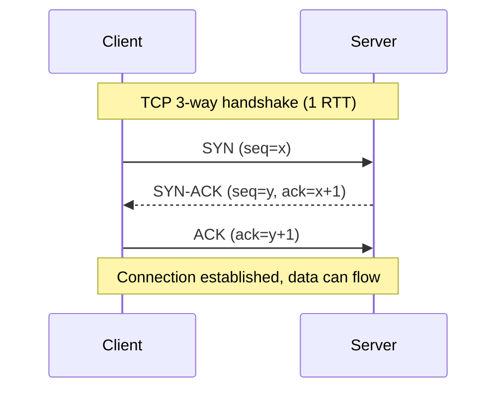
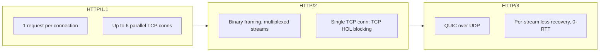
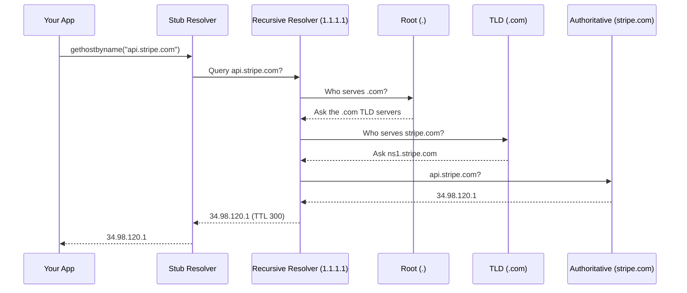
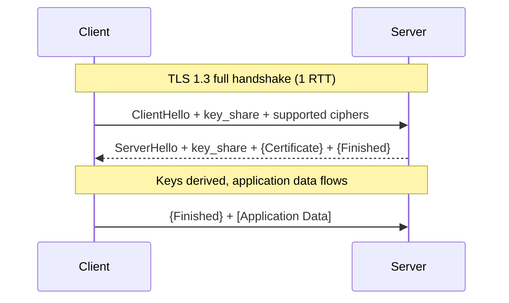
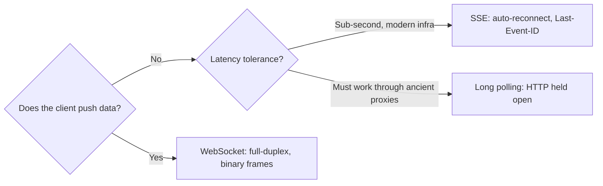

# Networking Fundamentals for System Design

> **TL;DR**: A first HTTPS connection pays for DNS, TCP and TLS 1.3 before any application data moves. That is 3 round trips, or roughly 300 ms across the Atlantic [^1]. Use TCP unless you can tolerate loss, serve HTTP/2 by default and HTTP/3 at the edge for mobile users, keep DNS TTLs short on anything that can fail over, never allow 0-RTT on writes, and default to SSE for server push. WebSockets are only worth their cost when the client pushes too.

Most system design problems look like questions about databases and caches until a user in another country opens your app. Then you discover that your 20 ms API takes half a second to feel responsive, and none of that time shows up in your server logs.

The delay lives in the network, and it is predictable. Once you can count the round trips in a connection, you can explain why a feature feels slow, why a failover took five minutes, and why "just use WebSockets" is often the wrong answer.

By the end of this lesson, you will be able to:

- [ ] Explain what each OSI layer does and where it shows up in real infrastructure
- [ ] Choose between TCP and UDP for a given workload
- [ ] Describe head-of-line blocking and how HTTP/2 and HTTP/3 address it
- [ ] Walk through a DNS lookup from your laptop to the authoritative server
- [ ] Sketch a TLS 1.3 handshake and explain when 0-RTT is safe
- [ ] Pick the right real-time transport: WebSocket, SSE, or long polling

## Where the First 300 ms Go

Think of mailing a package overseas. You hand it to the post office and it arrives, without you thinking about the cargo ship or customs. The internet hides its layers the same way, but every hidden step still takes time.

Here is what a browser pays before it can send its first request to a server it has never contacted:

| Step | Why it happens | Round trips |
|------|----------------|-------------|
| DNS lookup | Turn the name into an IP address | 1 (0 if cached) |
| TCP handshake | Agree to start a reliable connection | 1 |
| TLS 1.3 handshake | Agree on encryption keys | 1 (TLS 1.2 takes 2) |
| **Total before the request is sent** | | **3** |

At a 100 ms round trip, that is 300 ms of silence. The request and its response then take at least one more round trip. HTTP/3 removes one of these steps by combining the transport and encryption handshakes, which is most of its appeal on a first connection.

Physics sets the floor. Light in fiber travels at roughly 204,000 km/s, two-thirds of its speed in a vacuum, so a New York to London round trip can't go below about 56 to 62 ms [^4]. Real transatlantic round trips sit around 70 to 90 ms [^5]. You can't optimize that away, which is why the fix is usually fewer round trips or a server closer to the user.

You can measure all of this yourself with `curl`:

```bash
curl -so /dev/null https://example.com -w '
dns:        %{time_namelookup}s
tcp done:   %{time_connect}s
tls done:   %{time_appconnect}s
first byte: %{time_starttransfer}s
'
```

Each value is cumulative from the start of the request, so subtract neighbouring lines to get the cost of one step. Run it twice against a distant server, and the DNS line usually drops close to zero the second time because the answer is now cached.

## The Four Network Layers You Actually Touch

The OSI model has 7 layers, but system designers work with four. The TCP/IP model collapses them into Application, Transport, Internet and Link, and most engineers use the two models interchangeably.

| Layer | What it does | Examples you will see |
|-------|--------------|----------------------|
| 7 Application | The protocol your code speaks | HTTP, gRPC, SMTP, DNS |
| 4 Transport | End-to-end delivery between processes | TCP, UDP, QUIC |
| 3 Network | Routing packets between hosts | IP, ICMP |
| 2 Data Link | Moving frames on a wire or radio | Ethernet, Wi-Fi |

These numbers matter most when you choose a load balancer:

- **A layer 7 load balancer** parses HTTP, so it can route on path, headers or cookies. AWS ALB works this way, with a default idle timeout of 60 seconds [^2].
- **A layer 4 load balancer** only sees the TCP 5-tuple (source IP and port, destination IP and port, protocol) and forwards raw bytes. AWS NLB works this way, with a default TCP idle timeout of 350 seconds [^3].

> [!TIP]
> When debugging, ask "which layer is broken?" A DNS failure is layer 7. A dropped packet is layer 3 or 4. A flapping Wi-Fi signal is layer 2.

## TCP vs UDP: Pay for Reliability or Build Your Own

TCP gives you a reliable, ordered byte stream. It handshakes, retransmits lost packets, and paces itself to avoid congesting the network. UDP gives you a datagram: fire it and forget.



*TCP costs 1 round trip of dead air before any application byte flows; UDP skips this entirely.*

**Use TCP** when correctness matters more than speed: HTTP, database connections, file transfer, SSH.

**Use UDP** when loss is tolerable or you want to build your own reliability: DNS queries (one packet, retry if it drops), video calls (a dropped frame beats a stalled stream), game networking, and QUIC.

For most services this is not really a decision. TCP is the default, and you reach for UDP when a stalled stream would be worse than a missing packet.

## HTTP/1.1, HTTP/2, HTTP/3: Each Fixed the Last One's Bottleneck

Each generation of HTTP exists because of a specific bottleneck in the one before it.

**HTTP/1.1** (RFC 9112) is text-based and serial: one request at a time per TCP connection. Browsers work around this by opening up to 6 parallel connections per origin [^6]. You still see it everywhere in internal services, scripts and health checks.

**HTTP/2** (RFC 9113) multiplexes many requests over one TCP connection, using binary framing and HPACK header compression [^7]. The catch is TCP head-of-line (HOL) blocking. TCP delivers bytes in order, so one lost segment stalls every HTTP/2 stream until the retransmit arrives, including streams that had nothing to do with it [^1].

**HTTP/3** (RFC 9114) runs on QUIC (RFC 9000), which runs on UDP. QUIC gives each stream independent loss recovery, so a lost packet only stalls the stream it belonged to [^8]. It also combines the transport and TLS handshakes into a single round trip, and supports 0-RTT resumption for returning clients.



*HTTP/2 multiplexes over a single TCP stream (susceptible to TCP head-of-line blocking); HTTP/3 gives each stream its own loss recovery via QUIC over UDP.*

All three are in real use. In May 2023, Cloudflare reported HTTP/3 at about 28% of its global traffic, HTTP/2 at about 64% and HTTP/1.1 at about 9% [^9]. Its 2025 Radar data shows HTTP/3 at 21% of requests, HTTP/2 at 50% and HTTP/1.x at 29% [^10]. The two reports measure different things (traffic served versus requests received), so don't read the difference as HTTP/3 shrinking.

**What to pick:** serve HTTP/2 by default. Add HTTP/3 at the edge when you have mobile or global users, and keep HTTP/1.1 where simple tooling matters more than throughput.

## DNS: A Chain of Caches That Decides Your Failover Time

DNS translates names like `api.stripe.com` into IP addresses. The lookup walks a hierarchy, with caches along the way.



*Every DNS lookup is a hierarchical cache walk; caches at every layer mean popular names resolve in under a millisecond from warm cache.*

Your OS ships a small **stub resolver**, which forwards the query to a **recursive resolver** such as Cloudflare's 1.1.1.1 or your ISP's server. The recursive resolver walks from the root to the TLD to the authoritative nameserver, then caches the answer for as long as its TTL allows. Cloudflare handles approximately 67 million DNS queries per second across its authoritative and resolver services [^10].

DNS normally runs over UDP on port 53 and falls back to TCP when a response is too large. DNS-over-HTTPS (DoH) and DNS-over-TLS (DoT) add privacy by encrypting queries.

You can watch both the walk and the TTL:

```bash
dig +trace api.stripe.com   # follow the walk from the root down
dig api.stripe.com          # the second column of the answer is the remaining TTL
```

The TTL is the setting that bites in production, because it is the longest a cached client may keep using an old address:

| TTL | What you get | Use it for |
|-----|--------------|------------|
| 30 to 60 s | Fast failover, more resolver traffic | Anything that can fail over, like database endpoints |
| 300 s or more | Fewer lookups, but up to 5+ minutes of stale answers | Records that rarely change |

> [!IMPORTANT]
> Choose the TTL from your failover target. If you promise recovery in one minute, a 300-second TTL has already broken that promise.

## TLS 1.3 and the 0-RTT Trap

TLS 1.3 (RFC 8446) cut the handshake from 2 round trips to 1 [^11]. On a mobile network where each round trip costs 50 to 200 ms, you feel that.



*TLS 1.3 cut the handshake to 1 RTT by letting the client ship its key_share in the first message; 0-RTT resumption adds early data to that flight but is replayable.*

The saving comes from a good guess. The client assumes which key exchange group the server prefers and sends its public key in the first message, so the server can answer with everything else in one reply.

For repeat visits, **0-RTT resumption** goes further: the client sends application data in its very first packet, using a key from the previous session. That speed has a price. 0-RTT data is not forward secret, and an attacker who captures it can replay it to your servers [^11].

A replayed page view is harmless. A replayed payment is not:

```http
POST /transfer-money HTTP/1.1
Host: bank.example.com
Content-Type: application/json

{"to": "alice", "amount": 500}
```

If that request arrives over 0-RTT, a captured copy can be sent again and the transfer may run twice. So the rule is to accept early data only for safe, idempotent requests, and answer anything else with HTTP 425 Too Early, which makes the client retry after a full handshake. Cloudflare leaves 0-RTT off by default and rejects non-idempotent methods over it [^12].

If you terminate TLS yourself, the proxy has to tell your app which requests arrived early. In nginx:

```nginx
ssl_early_data on;
proxy_set_header Early-Data $ssl_early_data;
```

Your app then returns 425 for any non-GET request that carries `Early-Data: 1`.

> [!WARNING]
> **Never use 0-RTT for state-changing requests.** Leaving it off entirely is a perfectly good choice if you aren't sure every path is idempotent.

## Real-Time Updates: Default to SSE, Not WebSockets

HTTP is request-response. For server-pushed data like chat messages, stock ticks and notifications, you need a long-lived channel, and there are three options.

**Long polling** opens an HTTP request that the server holds until data is ready or a timeout fires. It works through any proxy, but every message is a fresh HTTP request with full headers.

**Server-Sent Events (SSE)** is a long-lived HTTP response with `Content-Type: text/event-stream`. It is one-way, from server to client, and it reconnects on its own. The format is simple enough to read on the wire:

```text
id: 42
event: score
data: {"home": 2, "away": 1}

```

The browser side is just as small. If the connection drops, `EventSource` reconnects and sends `Last-Event-ID: 42`, so the server knows where to resume:

```js
const stream = new EventSource('/scores');
stream.addEventListener('score', (e) => render(JSON.parse(e.data)));
```

**WebSockets** (RFC 6455) upgrade an HTTP connection into a full-duplex binary channel with only 2 to 14 bytes of framing per message [^13]. You get true two-way traffic, and in exchange you own sticky sessions, reconnect logic and proxy quirks.



*Default to SSE for server-to-client streams; WebSockets only when the client also pushes; long polling only as universal fallback.*

**What to pick:** start with SSE. It covers dashboards, notifications and LLM token streams without sticky sessions. Move to WebSockets when the client sends frequent data of its own, like chat input, game state or cursor positions. Keep long polling for environments that block everything else.

SSE has one limit to plan for. Over HTTP/1.1, each stream uses one of the browser's 6 connections per domain [^6]. Over HTTP/2 the limit becomes the negotiated `SETTINGS_MAX_CONCURRENT_STREAMS`. RFC 9113 sets no initial limit but recommends a value of at least 100, and 100 is a common server setting.

## What Cloudflare's HTTP/3 Rollout Showed

Cloudflare rolled out HTTP/3 across its network starting in September 2019, while the QUIC spec was still a draft [^1]. Its edge runs on its own open-source QUIC library, quiche, behind Anycast BGP.

Its April 2020 production benchmark is a useful reality check [^1]:

| Metric | HTTP/2 | HTTP/3 |
|--------|--------|--------|
| Average time to first byte | 201 ms | 176 ms (12.4% faster) |
| 15 KB page load | 458 ms | 443 ms |

That is a real improvement but not a dramatic one. The gains come mainly from removing the extra TLS round trip and from per-stream loss recovery on lossy mobile links, while on fast wired links the difference is marginal. By May 2023, HTTP/3 carried about 28% of Cloudflare's traffic, and about 40% of requests from Chrome Mobile [^9].

**The takeaway:** treat HTTP/3 as a win for mobile and global users, not a blanket speed-up, and keep a fallback. Advertise it with `Alt-Svc` alongside HTTP/2, because some enterprise firewalls still block outbound UDP on port 443.

## Five Mistakes That Cause Real Incidents

### A long DNS TTL on a failover record

After an RDS CNAME failover, clients keep connecting to the dead IP until their cached answer expires [^14]. With a 300-second TTL, that can mean 5 minutes of errors after the database has already recovered.

**Fix:** use 30 to 60 second TTLs on failover-targeted records.

### A proxy that quietly undoes connection reuse

You deploy HTTP/2 end to end on paper, but your proxy terminates it and opens a fresh upstream connection for every request, so each one pays a new handshake.

```nginx
# Bad: no connection reuse to the upstream
location / {
    proxy_pass http://10.0.0.1:8080;
}

# Better: reuse a pool of upstream connections
upstream api {
    server 10.0.0.1:8080;
    keepalive 32;
}
location / {
    proxy_pass http://api;
    proxy_http_version 1.1;
    proxy_set_header Connection "";
}
```

This restores connection reuse. It doesn't give you multiplexing to the upstream, so use a proxy like Envoy if you need HTTP/2 on that hop.

### WebSockets for one-way data

If data only flows from server to client, WebSockets add sticky sessions, custom reconnect logic and proxy problems, and you get nothing back for it.

**Fix:** use SSE with `EventSource`, which reconnects automatically [^6].

### 0-RTT on non-idempotent requests

An attacker captures a `POST` sent over 0-RTT and replays it, and the server processes it more than once.

**Fix:** reject 0-RTT on POST, PUT and DELETE at your TLS terminator, and answer with HTTP 425 Too Early [^12].

### SSE stalling at the 6-connection limit

An SSE-heavy app works fine until a user opens a seventh tab, which can't open a stream because the browser has hit its per-domain limit over HTTP/1.1. Chrome and Firefox have marked this "Won't fix" [^6].

**Fix:** serve SSE over HTTP/2, or shard across subdomains.

## Which Transport to Pick

| Transport | Pros | Cons | Best when | Our pick |
|-----------|------|------|-----------|----------|
| TCP | Reliable ordered byte stream, congestion control | 1-RTT handshake, head-of-line blocking on lossy links | Correctness-critical traffic (HTTP, databases, SSH) | Default for APIs and data |
| UDP | Zero setup, low per-packet overhead | No reliability, ordering or congestion control | Video, voice, games, DNS, QUIC | When you build reliability on top |
| HTTP/1.1 | Universal, easy to debug with curl, simple proxies | One request at a time per connection, verbose headers | Internal services, scripts, health checks | When simplicity beats throughput |
| HTTP/2 | Multiplexing on one connection, HPACK compression | TCP head-of-line blocking on lossy links | Modern web over reliable networks | Default for most web traffic |
| HTTP/3 | Per-stream loss recovery, 0-RTT resumption | UDP blocked on some enterprise networks | Mobile-first traffic, global users | When your edge advertises `Alt-Svc` |
| WebSocket | Full-duplex, 2 to 14 byte frame overhead [^13] | Sticky sessions, proxy quirks, custom reconnects | Chat, multiplayer games, collaborative editing | When the client also pushes |
| SSE | Plain HTTP, auto-reconnect via `Last-Event-ID` | One direction only, text-only payload | Dashboards, notifications, LLM token streams | Default for server push |
| Long polling | Works through any HTTP proxy or firewall | Full HTTP round trip per message | Behind middleboxes that block the others | When universal compatibility is required |

## Exercise

> **Design Challenge**: You are building a live sports score app for 10 million concurrent users. Scores update every few seconds during a match. Latency should be under 1 second. Design the client-to-server transport. Which protocol do you pick, and why? How do you handle reconnects, scaling, and cold starts?

<details>
<summary>Hint</summary>

Ask yourself: does the client ever push data, or only listen? How often do clients reconnect? What happens when a CDN terminates the connection? The answer is probably not WebSockets.

</details>

<details>
<summary>Solution</summary>

**Pick SSE.** The data flow is one-way (server pushes scores), the payload is tiny JSON, and SSE reconnects automatically with a `Last-Event-ID` header so clients resume where they left off. WebSockets would work but add complexity: sticky sessions, heartbeats, custom reconnect logic, and full-duplex framing you do not need.

**Topology:** A fleet of "fanout" servers each holding roughly 100K SSE connections. Behind them, a Redis pub/sub or Kafka topic distributes score updates. When a match updates in the origin database, one service publishes, and all fanout servers push to their connected clients.

**Scaling:** 10M / 100K = 100 fanout servers, spread across 3 to 5 regions for latency. Use a layer 4 load balancer (NLB on AWS) that hashes by client IP for session distribution. HTTP/2 multiplexing is not helpful here because each client has one SSE stream.

**Cold start:** New clients hit a CDN first for the initial page, then open the SSE stream directly to a fanout server. Prewarm the process with a health check that opens a dummy connection.

**Reconnects:** The browser's `EventSource` reconnects automatically. Server sends an `id:` field with each event. On reconnect, the client sends `Last-Event-ID`, and the server replays missed events from a short Redis buffer (last 30 seconds).

</details>

## Quick Reference

| Topic | Remember this |
|-------|---------------|
| First connection | DNS + TCP + TLS 1.3 = 3 round trips before the request. TLS 1.2 adds a fourth. |
| TCP vs UDP | TCP trades latency for reliability, UDP the reverse. QUIC builds reliable streams on top of UDP. |
| HTTP/2 | Fixed one-request-per-connection, but inherited TCP head-of-line blocking. |
| HTTP/3 | Per-stream loss recovery. About 12.4% faster TTFB in Cloudflare's test, with the biggest gains on lossy mobile networks. |
| DNS TTL | Short for fast failover, long for less resolver load. |
| 0-RTT | Fast but replayable. Never use it for non-idempotent requests. |
| Server push | Default to SSE. WebSockets when the client pushes too. Long polling as a last resort. |

## Further Reading

- [RFC 9114: HTTP/3](https://www.rfc-editor.org/rfc/rfc9114) - The definitive HTTP-over-QUIC spec; read sections 1 to 3 for the motivation and stream mapping.
- [RFC 8446: TLS 1.3](https://www.rfc-editor.org/rfc/rfc8446) - Sections 2 and 4 for the handshake; Appendix E for the security analysis of 0-RTT.
- [Comparing HTTP/3 vs HTTP/2 Performance](https://blog.cloudflare.com/http-3-vs-http-2/) - Cloudflare's 2020 production benchmark with TTFB numbers, page load sweeps, and CUBIC vs BBR analysis.
- [Even faster connection establishment with QUIC 0-RTT](https://blog.cloudflare.com/even-faster-connection-establishment-with-quic-0-rtt-resumption/) - Why Cloudflare disables 0-RTT by default and how they handle replay protection.
- [How Discord Scaled Elixir to 5,000,000 Concurrent Users](https://discord.com/blog/how-discord-scaled-elixir-to-5-000-000-concurrent-users) - Real WebSocket fan-out at scale: 500K sessions per Elixir VM, custom batching, and cascading failure patterns.
- [MDN: EventSource](https://developer.mozilla.org/en-US/docs/Web/API/EventSource) - Authoritative reference on SSE browser behavior, the 6-connection limit, and `Last-Event-ID` semantics.
- [The QUIC Transport Protocol: Design and Internet-Scale Deployment](https://research.google/pubs/the-quic-transport-protocol-design-and-internet-scale-deployment/) - Google's SIGCOMM 2017 paper on deploying QUIC at 7% of internet traffic.
- DDIA Chapter 8 (Designing Data-Intensive Applications, Martin Kleppmann), pp. 274 to 287 - "The Trouble with Distributed Systems" on unreliable networks and timing assumptions.

## Flashcards

**Q:** What are the 3 round trips a first HTTPS connection pays before sending application data?
**A:** DNS lookup (1 RTT to resolve the name), TCP handshake (1 RTT for SYN/SYN-ACK/ACK), and TLS handshake (1 RTT for TLS 1.3, 2 for TLS 1.2). HTTP/3 collapses transport + TLS into 1 RTT.

**Q:** Why does HTTP/2 suffer from head-of-line blocking even though it multiplexes?
**A:** HTTP/2 runs over a single TCP connection. TCP guarantees ordered delivery, so one lost packet blocks all multiplexed streams until the retransmit arrives.

**Q:** How does HTTP/3 solve TCP head-of-line blocking?
**A:** HTTP/3 runs on QUIC over UDP. QUIC gives each stream independent loss recovery, so a lost packet only stalls the stream it belonged to. Other streams continue unblocked.

**Q:** What does a TLS 1.3 full handshake cost in round trips, and why is 0-RTT dangerous?
**A:** 1 RTT for a full handshake. 0-RTT uses a pre-shared key to send data in the first packet but is vulnerable to replay attacks. Only use it for idempotent GET requests.

**Q:** When would you pick UDP over TCP?
**A:** When packet loss is tolerable or you will build your own reliability: video calls, voice, games, DNS queries, and QUIC (which builds reliable streams on top of UDP).

**Q:** What is the difference between a recursive and iterative DNS query?
**A:** A recursive resolver accepts your query and does all the work (walking root, TLD, authoritative servers on your behalf). In an iterative query, each server answers "go ask X" and the client does the walking.

**Q:** Pick a transport: real-time stock ticker pushed to a browser, clients never send data. WebSocket, SSE, or long polling?
**A:** SSE. Data flows one direction (server to client), SSE auto-reconnects with `Last-Event-ID`, and it works over any HTTP infrastructure without sticky sessions.

**Q:** What happens if you set a DNS TTL of 300 seconds and your database fails over to a new IP?
**A:** Clients behind resolvers that cached the old IP keep connecting to the dead server for up to 5 minutes. Use 30 to 60 second TTLs for failover-targeted records.

**Q:** How many concurrent connections per domain does HTTP/1.1 allow in browsers, and how does HTTP/2 change this?
**A:** Browsers cap HTTP/1.1 at 6 connections per domain. HTTP/2 multiplexes over a single connection with a negotiated max of 100 concurrent streams (server-configurable).

**Q:** What is the theoretical minimum round-trip time between New York and London, and why?
**A:** About 56 to 62 ms. Light travels at roughly 204,000 km/s in fiber (two-thirds the speed of light in vacuum). Real-world transatlantic RTTs are 70 to 90 ms due to routing, queuing, and middlebox delays.

## References

[^1]: Sreeni Tellakula, "Comparing HTTP/3 vs. HTTP/2 Performance", Cloudflare Blog, April 14, 2020. https://blog.cloudflare.com/http-3-vs-http-2/
[^2]: AWS, "Edit attributes for your Application Load Balancer" (default 60 s idle timeout). https://docs.aws.amazon.com/elasticloadbalancing/latest/application/edit-load-balancer-attributes.html
[^3]: AWS, "Introducing NLB TCP configurable idle timeout" (default 350 s TCP idle timeout). https://aws.amazon.com/blogs/networking-and-content-delivery/introducing-nlb-tcp-configurable-idle-timeout/
[^4]: M2 Optics, "Calculating Optical Fiber Latency", 2012. Refractive index of standard single-mode fiber (G.652) at 1550 nm is approximately 1.468, giving a propagation speed of roughly 204,000 km/s. https://www.m2optics.com/blog/bid/70587/calculating-optical-fiber-latency
[^5]: Verizon IP Latency SLA data (transatlantic London-New York 90 ms or less). https://verizon.com/business/terms/latency/
[^6]: MDN Web Docs, "EventSource" and associated browser bug trackers for the 6-connection-per-domain limit. https://developer.mozilla.org/en-US/docs/Web/API/EventSource
[^7]: Martin Thomson, Cory Benfield (eds.), "HTTP/2", RFC 9113, June 2022. https://www.rfc-editor.org/rfc/rfc9113
[^8]: Mike Bishop (ed.), "HTTP/3", RFC 9114, June 2022. https://www.rfc-editor.org/rfc/rfc9114
[^9]: David Belson, Lucas Pardue, "Examining HTTP/3 usage one year on", Cloudflare Blog, June 6, 2023. https://blog.cloudflare.com/http3-usage-one-year-on/
[^10]: Cloudflare, "Radar 2025 Year in Review", December 15, 2025. https://blog.cloudflare.com/radar-2025-year-in-review/
[^11]: Eric Rescorla, "The Transport Layer Security (TLS) Protocol Version 1.3", RFC 8446, August 2018. https://www.rfc-editor.org/rfc/rfc8446
[^12]: Alessandro Ghedini, "Even faster connection establishment with QUIC 0-RTT resumption", Cloudflare Blog, November 20, 2019. https://blog.cloudflare.com/even-faster-connection-establishment-with-quic-0-rtt-resumption/
[^13]: Ian Fette, Alexey Melnikov, "The WebSocket Protocol", RFC 6455, December 2011. https://www.rfc-editor.org/rfc/rfc6455
[^14]: AWS re:Post, "Resolve Aurora failover downtime and connection errors". https://repost.aws/knowledge-center/failovers-aurora-mysql
