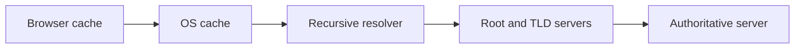
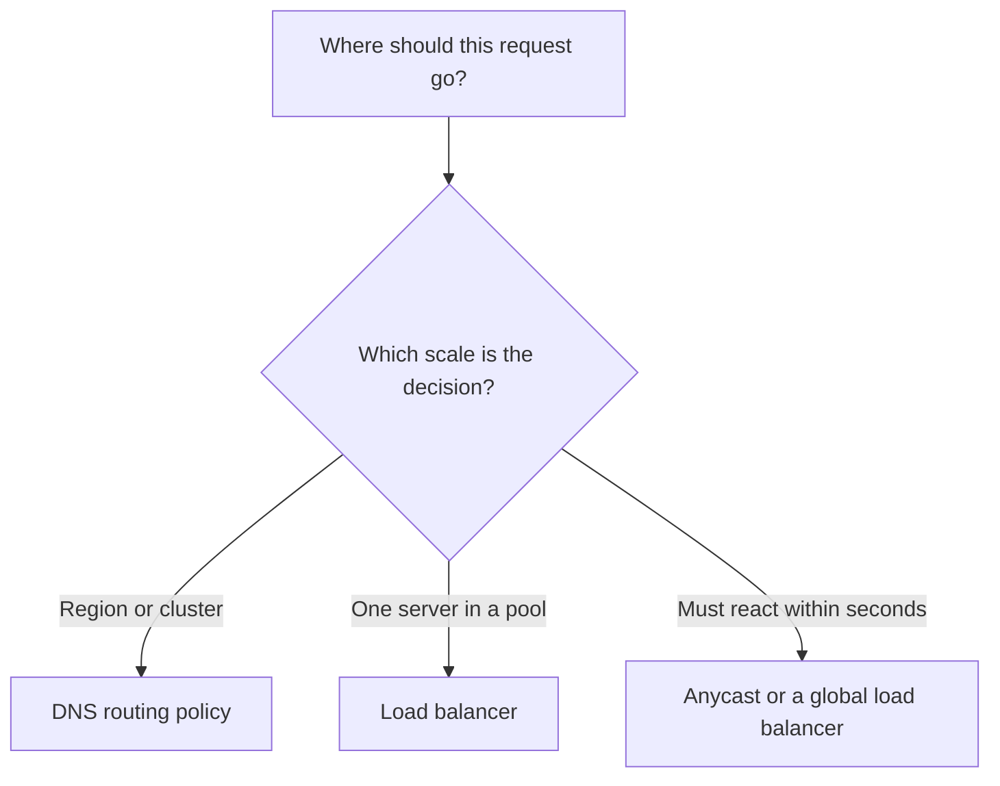

# DNS as a Traffic Router: Records, TTLs and Routing Policies

> **TL;DR**: DNS turns a name into an address, and because it answers before any connection exists, it is also the first place you can decide where a user goes. It is coarse and cached, so use it to choose a region or a cluster, and use load balancers for everything finer.

## Learning Objectives

After this module, you will be able to:

- [ ] Choose between A, AAAA, CNAME, NS and MX records
- [ ] Explain why a DNS change does not take effect instantly
- [ ] Pick a routing policy for a canary release, a multi-region site or a compliance rule
- [ ] Decide what belongs in DNS and what belongs in a load balancer

## Intuition

Think of DNS as the signs at a motorway junction. They send drivers towards the right city long before anyone reaches a car park. A sign cannot see that one car park just filled up, and repainting it takes time because drivers already on the road have read the old one. A car park attendant, like a load balancer, reacts in seconds but only handles the cars that have already arrived.

## Theory

### The records you will actually use

| Record | What it does | Example use |
|---|---|---|
| A / AAAA | Maps a name to an IPv4 / IPv6 address | `api.example.com` to a load balancer IP |
| CNAME | Maps a name to another name | `www.example.com` to a CDN hostname |
| NS | Names the servers that are authoritative for a zone | Delegating a subdomain to another team |
| MX | Names the mail servers for a domain | Receiving email |
| TXT | Holds free-form text | Domain ownership checks, SPF |

A CNAME cannot sit at the zone apex (`example.com` itself), because the apex must also hold NS and SOA records. Many DNS providers offer an ALIAS or ANAME record to get the same effect there.

### Lookups are chains of caches

*Every step can answer from its cache, so a change only reaches users once the old answers expire.*

Each answer carries a time to live (TTL) that says how long it may be cached. A short TTL means faster changes but more lookups, which adds latency for users and queries for you to pay for. A long TTL means the reverse.

> [!WARNING]
> A TTL is a request, not a guarantee. Some resolvers and clients keep answers longer, so a DNS failover always has a tail of users still going to the old address. Lower the TTL well before a planned move, because resolvers that cached the old record keep the old TTL until it runs out.

### Routing policies

Managed DNS services such as Route 53 and Cloudflare can return different answers to different users.

| Policy | How it chooses | Good for |
|---|---|---|
| Weighted | Splits answers by percentage | Canary releases, A/B tests, draining a cluster for maintenance |
| Latency-based | Region with the lowest measured latency to the resolver | Multi-region apps where speed matters most |
| Geolocation | The user's country or continent | Data residency, localized content, licensing rules |
| Failover | Primary unless its health check fails | Active-passive disaster recovery |

Note that the service usually sees the recursive resolver rather than the user. The EDNS Client Subnet extension can pass along part of the user's address when the resolver supports it, so location-based answers are approximate.

### DNS or load balancer?

*DNS picks the broad destination, and faster layers handle what happens after that.*

## Real-World Example

A team running in two regions can combine these. Latency-based records send each user to the closer region, and health checks remove a failing region from the answers. Inside each region, a load balancer spreads requests across servers. To release a new version, a small weighted record sends a share of traffic to the new stack first. If the region fails, recovery time is roughly the health check interval plus the TTL, so that sum is what the team should promise, not the TTL alone.

## Trade-offs

| Benefit | Cost |
|---|---|
| Works before a connection exists, with nothing to deploy on the client | Changes spread slowly and unevenly because of caching |
| Very cheap way to split traffic between regions | Sees resolvers rather than users, so targeting is approximate |
| Survives the loss of a whole region | Adds a lookup to the first request |
| Managed services handle huge query volumes | A DNS outage or attack can make a healthy site unreachable |

The 2016 attack on the DNS provider Dyn showed that last risk: many major sites were up, but users could not find them. Running a second DNS provider is the usual protection.

## Common Pitfalls

> **Treating DNS as a load balancer.** Round robin DNS does not know which servers are healthy or busy, and caching makes the split lumpy. Use it between clusters, not between servers.

> **Forgetting the TTL during a migration.** Lowering the TTL an hour before a move does nothing if the old TTL was a day. Lower it at least one old TTL ahead of time.

> **Health checks that test the wrong thing.** A check that only opens a port can pass while the app is failing. Check an endpoint that exercises the real dependencies.

## Exercise

Your app runs in `eu-west` and `us-east`. EU customers' data must stay in the EU, and everyone else should get the fastest region. Design the records, including what happens to EU users if `eu-west` fails.

<strong>Solution sketch</strong>

Use geolocation records so EU users always get `eu-west`, with a default record for everyone else that uses latency-based routing across both regions. Attach health checks. For EU users, do not fail over to `us-east` automatically, since that would break the residency rule. Either run a second EU region as the failover target or show a maintenance page.

## Key Takeaways

- DNS is the earliest routing decision you can make, and also the slowest to change.
- Recovery time for a DNS failover is about the health check interval plus the TTL, with a tail from resolvers that cache longer.
- Use DNS to choose a region or cluster, and a load balancer to choose a server.
- Weighted, latency, geolocation and failover policies cover most needs.
- Protect against DNS provider failure, because it can take down an otherwise healthy site.

## Further Reading

- [Networking fundamentals](../part-0-prerequisites/00-networking-fundamentals.md) explains how a lookup works step by step.
- [Multi-region architecture](../part-5-architecture-patterns/08-multi-region-architecture.md) covers failover beyond DNS.
- [Design a DNS service](../part-8-case-studies/39-dns-service.md) looks at DNS from the operator's side.

## Flashcards

**Q:** Why can't a CNAME be placed at the zone apex?
**A:** The apex must hold NS and SOA records, and a CNAME cannot coexist with other records for the same name. Providers offer ALIAS or ANAME records as a workaround.

**Q:** What sets the rough recovery time of a DNS failover?
**A:** The health check detection time plus the record's TTL, with a tail from resolvers that cache for longer.

**Q:** Which routing policy suits a canary release?
**A:** Weighted routing, which sends a chosen percentage of answers to the new stack.

**Q:** Why is DNS location targeting only approximate?
**A:** The service normally sees the recursive resolver, not the user, unless EDNS Client Subnet passes along part of the user's address.

**Q:** When should you lower a TTL before a migration?
**A:** At least one old TTL ahead of time, since resolvers keep the old answer until the old TTL expires.

## References

- Donne Martin, "Domain name system," The System Design Primer. https://github.com/donnemartin/system-design-primer#domain-name-system
- AWS documentation, "Choosing a routing policy." https://docs.aws.amazon.com/Route53/latest/DeveloperGuide/routing-policy.html
