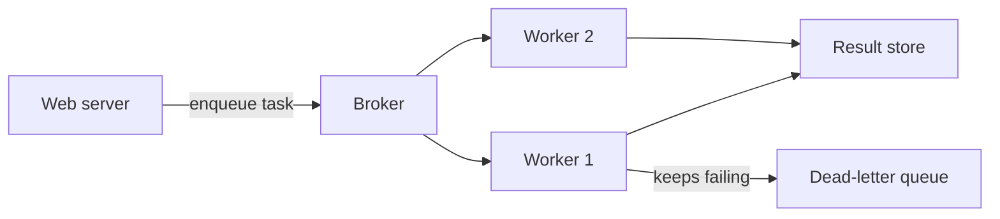
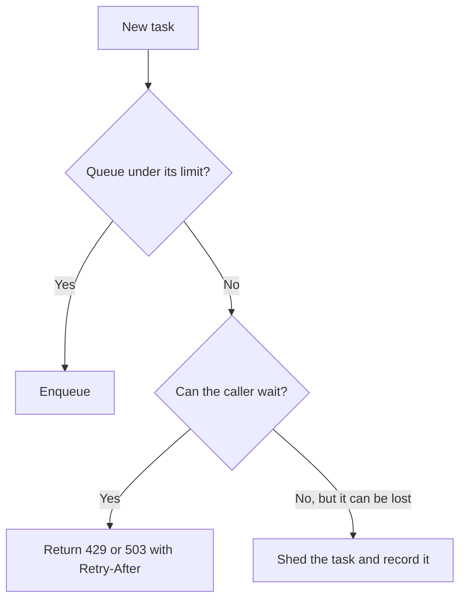

# Task Queues: Running Work in the Background

> **TL;DR**: A task queue lets a web request say "do this later" and return immediately, while workers do the slow part. The hard parts are not the queue itself: tasks will run more than once, some will fail forever, and the queue can grow faster than you can drain it.

## Learning Objectives

After this module, you will be able to:

- [ ] Explain how a task queue differs from a message queue
- [ ] Decide which work should leave the request path
- [ ] Make tasks safe to run more than once
- [ ] Set up retries, dead-letter queues and back pressure

## Intuition

A coffee shop takes your order and payment, hands you a ticket and lets you step aside. Baristas work through the tickets. The till stays fast even when the drinks are slow, and at rush hour the shop can add baristas without changing the till. But if tickets pile up faster than drinks get made, someone must eventually stop taking orders or warn customers about the wait. That decision is back pressure.

## Theory

### Message queue or task queue?

A **message queue** moves data between services: a producer states that something happened, and consumers decide what to do about it. A **task queue** sits one level higher: it carries a named job with arguments, and it manages running that job, including retries, scheduling and results. Task queues are usually built on a broker such as Redis, RabbitMQ or SQS.



*The web server returns as soon as the task is enqueued, and workers scale separately from it.*

### What belongs in a task queue

Good candidates are slow, can be retried, and do not need an answer before responding: sending email, resizing images, generating reports, calling flaky third-party APIs and bulk imports.

Keep work synchronous when it is cheap, or when the user needs the result right away. A queue adds latency and moving parts, so moving a 5 ms calculation behind one only makes things worse.

### Tasks run at least once

A worker can crash after doing the work but before acknowledging it, and the broker will then hand the task to another worker. Most task queues therefore give you **at-least-once** delivery, and every task has to tolerate running twice.

```python
def charge_invoice(invoice_id):
    invoice = db.get_invoice(invoice_id)
    if invoice.paid:          # already done by an earlier attempt
        return
    payment_api.charge(
        amount=invoice.total,
        idempotency_key=f"invoice-{invoice_id}",  # the provider ignores duplicates
    )
    db.mark_paid(invoice_id)
```

Two habits help here:

- **Pass IDs, not data.** Send `invoice_id` and load the current state when the task runs. Copies of data in the queue go stale.
- **Enqueue after commit.** If a task is enqueued before the database transaction commits, a worker can run before the row exists. If it is enqueued after commit, a crash in between loses it. The [transactional outbox](../part-3-distributed-systems-theory/06-distributed-transactions.md) closes that gap by writing the task in the same transaction.

### Acknowledgement timing

When a worker acknowledges a task decides what a crash costs:

| Acknowledge | If the worker crashes | Use for |
|---|---|---|
| On receipt | The task is lost | Work that is safe to lose |
| After completion | The task runs again | Most work, as long as it is idempotent |

Some defaults favour the first row. Celery, for example, acknowledges just before running a task unless you set `acks_late`, so check your framework's default.

### Retries and dead letters

Retry temporary failures with exponential backoff and jitter, so that a struggling dependency is not hit by every retry at once. Limit the number of attempts, then move the task to a **dead-letter queue** where someone can inspect it. Without a limit, a task that can never succeed, known as a poison message, burns worker time forever.

### Scheduling and priorities

Task queues commonly support delayed tasks ("send this reminder in an hour") and periodic tasks. For critical schedules, run a single scheduler with a failover plan, so that a job is not fired twice or missed. Use [a dedicated job scheduler](../part-8-case-studies/29-job-scheduler.md) when schedules are a product feature.

Run separate queues and worker pools for different kinds of work. If password reset emails share a queue with a nightly export, the export can delay every reset.

### Back pressure

If tasks arrive faster than workers finish, the queue grows without limit. Eventually it can exhaust the broker's memory, and by then many tasks are too old to be useful. Back pressure limits the damage:



*A bounded queue turns an invisible backlog into a clear signal that callers can act on.*

Alert on the **age of the oldest task**, not just the queue length. A thousand tasks may be fine for one queue and a disaster for another, while age directly measures how late the work is.

## Real-World Example

A photo app resizes uploads in the background. The upload request stores the original in object storage, writes a row marked `processing`, enqueues `resize_photo(photo_id)` and returns. A worker makes the thumbnails, using fixed output names so that running twice overwrites the same files, then marks the row `ready`. Clients poll for the status or get notified. When a promotion doubles uploads, the team adds workers based on the age of the oldest task. The API servers do not change.

## Trade-offs

| Benefit | Cost |
|---|---|
| Fast responses for users | Results arrive later, so the UI must show progress |
| Workers scale separately from web servers | A broker to run, plus worker fleets to monitor |
| Retries absorb temporary failures | Every task must be idempotent |
| Spikes get smoothed out | Backlogs can hide problems unless you alert on them |

## Common Pitfalls

> **Non-idempotent tasks.** A retry sends the customer a second email or a second charge. Assume every task can run twice.

> **Large payloads in the queue.** Brokers are not built for big blobs. Store the file elsewhere and enqueue a reference.

> **Retrying forever.** Without a limit and a dead-letter queue, poison messages use up workers indefinitely.

> **One queue for everything.** A slow batch job starves urgent work. Separate queues by priority and expected duration.

> **No task timeouts.** A task stuck on a dead connection holds a worker forever. Set a timeout on every task and on the network calls inside it.

## Exercise

Your signup flow sends a welcome email inside the request. The email provider sometimes takes 10 seconds and signups time out. Redesign it, covering what happens if the provider is down for an hour, and how to avoid duplicate emails.

<details>
<summary><strong>Solution sketch</strong></summary>

Write the user and an outbox row in the same transaction, then let a relay enqueue `send_welcome_email(user_id)`. Retry with exponential backoff and jitter, with enough attempts to cover an hour before moving to a dead-letter queue. To prevent duplicates, record `welcome_sent_at`, check it first, and pass an idempotency key to the provider if it supports one. A crash between sending and recording can still duplicate an email without provider support, which is usually acceptable for a welcome email.

</details>

## Key Takeaways

- Task queues move slow, retryable work out of the request path.
- Delivery is at least once, so idempotency is required, not optional.
- Pass IDs instead of data, and be careful about enqueueing around transactions.
- Limit retries, keep a dead-letter queue, and set timeouts.
- Bound your queues, separate priorities, and alert on the age of the oldest task.

## Further Reading

- [Message queues and streaming](08-message-queues-streaming.md) covers the layer underneath.
- [Idempotency and exactly-once](../part-3-distributed-systems-theory/07-idempotency-exactly-once.md) explains how to survive duplicates.
- [Design a job scheduler](../part-8-case-studies/29-job-scheduler.md) applies these ideas at scale.

## Flashcards

**Q:** How does a task queue differ from a message queue?
**A:** A message queue moves data between services, while a task queue carries named jobs and manages running them, including retries, scheduling and results.

**Q:** Why must background tasks be idempotent?
**A:** Delivery is at least once. A worker can crash after doing the work but before acknowledging it, so the task runs again.

**Q:** Why pass an ID instead of the full data?
**A:** Payloads stay small, and the worker reads the current state instead of a stale copy.

**Q:** What is a dead-letter queue for?
**A:** It holds tasks that used up their retries, so poison messages stop consuming workers and can be inspected.

**Q:** What should you alert on for a queue?
**A:** The age of the oldest task, since it directly measures how late the work is.

**Q:** What is back pressure in a task queue?
**A:** Limiting the queue and telling producers to slow down, for example with a 429 or 503, instead of letting a backlog grow without limit.

## References

- Donne Martin, "Asynchronism," The System Design Primer. https://github.com/donnemartin/system-design-primer#asynchronism
- Celery documentation, "Tasks." https://docs.celeryq.dev/en/stable/userguide/tasks.html
