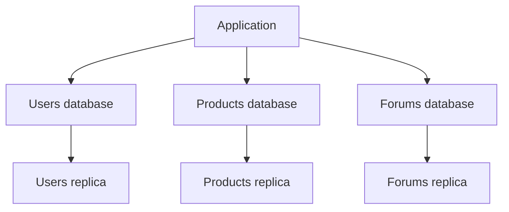
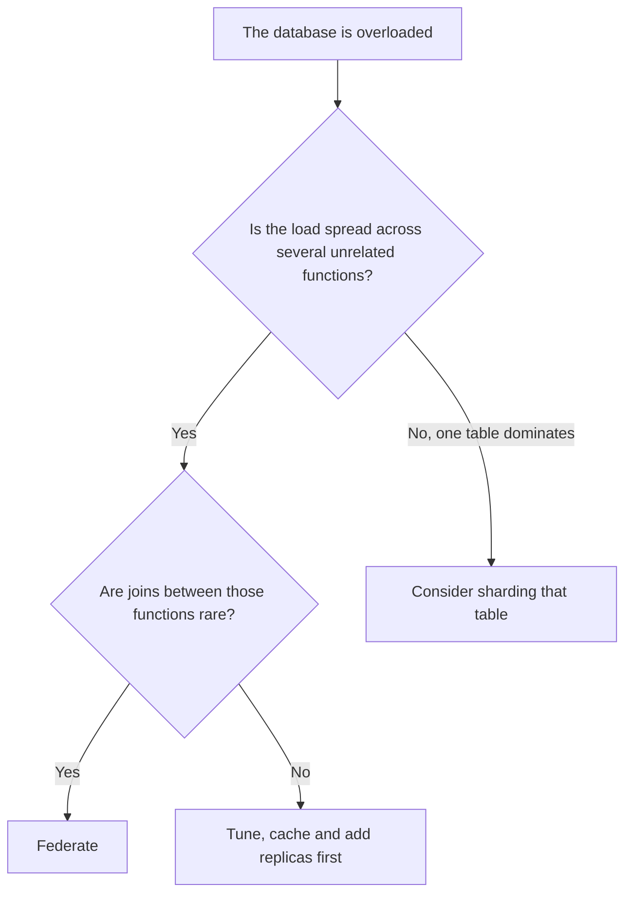

# Database Federation: Splitting Databases by Function

> **TL;DR**: Federation, also called functional partitioning, gives each business function its own database, such as users, products and forums. It is usually much simpler than sharding, and often buys a lot of headroom. The price is losing joins and single transactions across those functions.

## Learning Objectives

After this module, you will be able to:

- [ ] Explain how federation differs from sharding and replication
- [ ] Decide whether federation or sharding fits a bottleneck
- [ ] Replace cross-database joins and transactions
- [ ] Plan a federation migration without downtime

## Intuition

A small company keeps everything in one big filing room, and staff queue at the door. One fix is to give HR, Finance and Sales their own rooms. Each room is quieter, and each department can be organized its own way. But answering "how much did each employee's sales bring in?" now takes a trip to two rooms. That is federation. Sharding would instead split one department's files across rooms by surname, which only helps when a single department outgrows its room.

## Theory

### Three different splits

| Approach | What is split | What it mainly helps |
|---|---|---|
| Replication | Nothing, it copies all the data | Reads and availability |
| Federation | Tables, by business function | Reads and writes across different functions |
| Sharding | Rows of one table, by key | Writes and size of a single huge table |

*Each function gets its own database and replicas, and the application knows which to use.*

### Why it helps

- **Less load on each database.** Traffic for each function goes to its own server.
- **Less replication lag.** Each replica only replays the writes for its own function.
- **More of the data fits in memory.** Smaller datasets have a better cache hit rate.
- **Failures are contained.** If the forums database fails, checkout can keep working.
- **Independent choices.** Each function can be tuned or upgraded on its own, and writes to different functions no longer compete with each other.

### What you give up

**Joins.** A query joining `users` and `orders` no longer works once they live in different databases. The usual replacements are:

- Joining in the application: fetch orders, then fetch the users in one batched query.
- Copying a few needed fields, such as storing the customer's name on the order, accepting that it can go stale.
- Feeding a separate read model or data warehouse for reports, often using [change data capture](../part-4-data-systems/04-change-data-capture.md).

**Transactions.** One atomic transaction cannot easily span two databases. Use a [saga or an outbox](../part-3-distributed-systems-theory/06-distributed-transactions.md), or reconsider the boundary. If two tables always change together, they probably belong in the same database.

**Foreign keys.** The database can no longer enforce relationships across functions, so the application must handle them, and orphaned rows become possible.

**Simplicity.** Each database needs its own backups, monitoring, failover and connection pools.

### Federation or sharding?

*Federation only helps if the data splits cleanly along function lines.*

Federation will not help when a single table or function holds most of the load. After federating, that one database has just as much work as before, and sharding may be the next step. The two can be combined, and federating first is common because it is simpler. As [the vertical vs horizontal scaling guide](../trade-offs/20-vertical-vs-horizontal-scaling.md) describes, teams generally try this kind of split before sharding.

### Migrating without downtime

1. **Find the seams.** Group tables by the code that uses them and list every join and transaction that crosses a group.
2. **Remove crossing queries first**, while everything still lives in one database. This is most of the work.
3. **Route through one layer.** Make all access to a function go through one module, so only one place needs to change.
4. **Copy the data.** Replicate the tables to the new server, using logical replication or change data capture.
5. **Switch over.** Stop writes briefly or use dual writes, confirm the data matches, then move traffic.
6. **Clean up.** Remove the old tables once the new database has been stable for a while.

## Real-World Example

An online marketplace runs everything on one Postgres primary, where product browsing is busy and order writes slow down at peak times. The analysis shows forums and product catalog tables are heavily read, but rarely joined to orders. The team moves forums first since it is the least risky, then the catalog. Orders keep a copy of the product name and price at purchase, which is what the business wants anyway. The orders database is now quieter, and its replica lag falls because it no longer replays catalog writes. No sharding was needed.

## Trade-offs

| Benefit | Cost |
|---|---|
| Much simpler than sharding | No joins or simple transactions across functions |
| Failures stay within one function | More databases to run and pay for |
| Each database can be tuned and scaled separately | The application must know where data lives |
| Lower replication lag and better cache hit rate | Does not help if one function dominates |

## Common Pitfalls

> **Splitting along the wrong seam.** If tables that are joined constantly end up apart, you get slow application joins and painful consistency bugs. Trace the real queries first.

> **Starting with the data move.** Moving tables before removing cross-function queries breaks production. Do the code changes first.

> **Assuming it fixes a hot table.** Federation moves a hot table but does not shrink it.

> **Federating too early.** Tuning, caching and replicas are cheaper. Split only when measurements say you must.

## Exercise

A SaaS database has `users`, `teams`, `invoices`, `payments` and `audit_logs`. Audit logs cause most of the writes. Invoices and payments always change together, and every request looks up the user and team. How would you split it?

<strong>Solution sketch</strong>

Move `audit_logs` first: it has the most write load, and it rarely needs joins since it can reference IDs. Keep `invoices` and `payments` together in a billing database, because they share transactions. Keep `users` and `teams` together, and cache them since every request reads them. Billing still needs customer details, so fetch them in the application or copy the billing contact onto the invoice.

## Key Takeaways

- Federation splits tables by function, while sharding splits rows of one table.
- It lowers load and replication lag, and contains failures, without routing every query by a shard key.
- You lose cross-function joins, transactions and foreign keys, so choose boundaries where these are rare.
- It does not help when one function dominates.
- Change the code first, then move the data.

## Further Reading

- [Database partitioning and sharding](06-database-partitioning-sharding.md) covers the next step if one function outgrows its database.
- [Distributed transactions](../part-3-distributed-systems-theory/06-distributed-transactions.md) explains sagas and two-phase commit.
- [Monolith vs microservices](../part-5-architecture-patterns/00-monolith-vs-microservices.md) discusses the same boundaries from the service side.

## Flashcards

**Q:** What is database federation?
**A:** Splitting a database by business function, so that for example users, products and forums each get their own database.

**Q:** How does federation differ from sharding?
**A:** Federation puts different tables on different servers. Sharding puts different rows of the same table on different servers.

**Q:** Why does federation reduce replication lag?
**A:** Each replica only replays writes for its own function, not for the whole application.

**Q:** What replaces a join across federated databases?
**A:** A batched join in the application, copied fields, or a separate read model or warehouse.

**Q:** When will federation not help?
**A:** When one table or function holds most of the load, or when functions are joined and updated together constantly.

## References

- Donne Martin, "Federation," The System Design Primer. https://github.com/donnemartin/system-design-primer#federation
