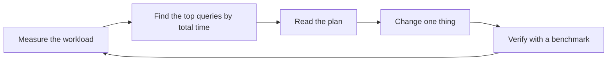
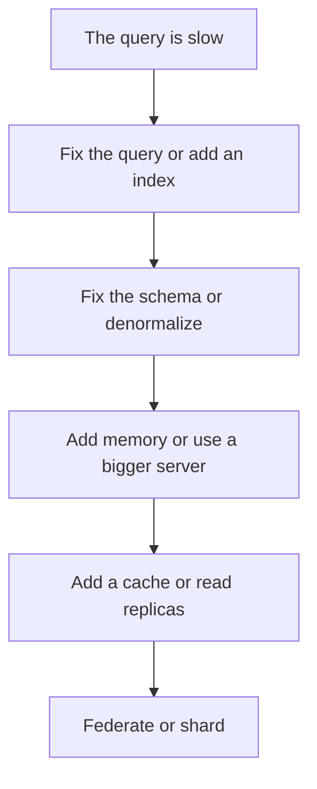

# SQL Tuning: Finding and Fixing Slow Queries

> **TL;DR**: Do not guess. Measure which queries use the most total time, read their plans, then fix the cheapest thing that works, which is usually a missing index or a badly written query. New hardware, caches and shards come after that.

## Learning Objectives

After this module, you will be able to:

- [ ] Use profiling and benchmarks to find the queries worth fixing
- [ ] Read a query plan and spot a bad scan
- [ ] Design composite and covering indexes
- [ ] Choose column types that avoid slow or incorrect behaviour
- [ ] Fix N+1 queries and slow pagination

## Intuition

A mechanic does not replace parts because a car feels slow. They connect the diagnostic tool, find the fault and fix that. Database tuning is the same. The query that looks scary is rarely the one hurting you. Often it is a 5 ms query running 20,000 times a minute.

## Theory

### The tuning loop



*Change one thing at a time, otherwise you cannot tell what helped.*

**Profile** to find the queries that matter. PostgreSQL has `pg_stat_statements` and MySQL has the slow query log and the Performance Schema. Sort by total time (average time multiplied by calls), rather than by the slowest single query.

**Benchmark** to test a change under load. Tools such as `pgbench`, `sysbench` and `k6` work. Use data of realistic size, because a plan that looks fine on a thousand rows can collapse on a hundred million.

### Reading a plan

`EXPLAIN` shows the plan the database chose, and `EXPLAIN ANALYZE` actually runs the query and reports real numbers, so be careful using it on writes.

```sql
EXPLAIN ANALYZE
SELECT id, total FROM orders
WHERE customer_id = 42 AND status = 'open'
ORDER BY created_at DESC LIMIT 20;
```

Look for these warning signs:

| In the plan | What it usually means |
|---|---|
| Sequential or full table scan on a big table | A missing or unusable index |
| Estimated rows far from actual rows | Stale statistics, so run `ANALYZE` |
| A sort step on many rows | An index could provide the order |
| Nested loop over a huge number of rows | A missing index on the join column |
| Many rows removed by a filter | The index is not selective enough |

### Designing indexes

Index the columns used in `WHERE`, `JOIN` and `ORDER BY`, but every index slows writes and takes space, so each must earn its place.

- **Column order matters.** A composite index on `(customer_id, status, created_at)` serves the query above. Put equality filters first, then the sort or range column. It cannot efficiently serve a filter on `status` alone.
- **Covering indexes** contain every column a query needs, so the table itself need not be read.
- **Partial indexes** cover only some rows, such as `WHERE status = 'open'`, and stay small when most rows are closed. PostgreSQL supports these directly.
- **Keep filters usable.** `WHERE LOWER(email) = 'a@b.com'` cannot use a plain index on `email`. Use an index on that expression, or store a normalized value. The same goes for a leading wildcard such as `LIKE '%term'`.
- **Remove unused indexes.** They cost writes and give nothing back. Check the database's index usage statistics.

For bulk loads, it can be faster to drop secondary indexes, load the data and then rebuild them.

### Choosing column types

| Guideline | Why |
|---|---|
| Use `DECIMAL` for money | Floating point cannot represent many decimal values exactly |
| Use `BIGINT` for IDs that could grow | A signed `INT` runs out at about 2.1 billion, and changing a large table's key is painful |
| Use `TIMESTAMPTZ` or the database's equivalent for times | Avoids time zone mistakes |
| Store a link rather than a large blob | Big values bloat backups and memory, so put files in object storage |
| Use `NOT NULL` where a value is required | Prevents bad data and simplifies queries |

> [!NOTE]
> Some older advice is engine-specific or out of date. Using `CHAR` over `VARCHAR` for speed made sense for some older MySQL storage layouts, but PostgreSQL's documentation says there is no performance advantage to `CHAR`. Check your engine's current documentation before following a rule.

### Fixing query patterns

**N+1 queries** are the most common problem in application code, and ORMs hide them:

```python
# 1 query for orders, then 1 more for each order: slow
for order in orders:
    print(order.customer.name)

# 2 queries in total: load all the customers at once
customers = load_customers([o.customer_id for o in orders])
```

**Deep pagination** gets slower as the offset grows, since the database still walks past all the skipped rows. Keyset pagination stays fast at any depth:

```sql
-- Slow when the offset is large
SELECT * FROM posts ORDER BY id DESC LIMIT 20 OFFSET 100000;

-- Fast at any depth, because it starts from the last row seen
SELECT * FROM posts WHERE id < 8841 ORDER BY id DESC LIMIT 20;
```

**`SELECT *`** reads columns you do not need, which can prevent a covering index from working and moves more data over the network.

**Expensive joins** that remain slow after indexing are a candidate for [denormalization](../trade-offs/21-normalization-vs-denormalization.md), but only for reads that have shown they need it.

### Splitting hot tables

- **Vertical split:** move frequently updated or rarely read columns to a side table. A wide `users` table with a constantly changing `last_seen_at` is a typical case.
- **Partitioning:** divide a big table by date or another key inside one database. Queries that filter on that key skip other partitions, and dropping an old partition is far cheaper than a large `DELETE`.

### Caching inside the database

Give the database enough memory for its working set, using `shared_buffers` in PostgreSQL or the buffer pool in InnoDB. Be careful with built-in query result caches. MySQL removed its query cache in version 8.0, because it became a bottleneck on busy, write-heavy systems. Caching results in [your application](20-caching-queries-vs-objects.md) gives you more control.

### Know when to stop



*Each step costs more than the one before it and adds more to operate, so work from the top.*

## Real-World Example

An orders page times out at peak. `pg_stat_statements` shows that the top query takes 40% of total database time, and `EXPLAIN ANALYZE` shows a scan of millions of rows followed by a sort, for 20 results. Adding an index on `(customer_id, created_at DESC)` replaces both the scan and the sort. The team creates it with `CREATE INDEX CONCURRENTLY` so that writes are not blocked. A planned read replica is no longer urgent. (This scenario is illustrative.)

## Trade-offs

| Change | Helps | Costs |
|---|---|---|
| New index | Reads on those columns | Slower writes, more storage |
| Denormalize | Complex reads | Duplicate data to keep in sync |
| Partition a table | Filtered queries, deleting old data | Queries without the key may get slower |
| Larger server | Everything, immediately | Money, and it only delays the problem |

## Common Pitfalls

> **Tuning without production-sized data.** Plans change with size, so test against realistic volumes.

> **Indexing every column.** Each index slows every write. Index for actual queries.

> **Creating an index that locks the table.** A plain index build can block writes on a live table. Use PostgreSQL's `CREATE INDEX CONCURRENTLY`, or check your engine's online options.

> **Chasing the slowest query.** A query that takes 10 seconds and runs once a day may matter less than a 5 ms query that runs constantly.

## Exercise

This query powers a feed and is slow: `SELECT * FROM posts WHERE author_id IN (...) AND deleted_at IS NULL ORDER BY created_at DESC LIMIT 20 OFFSET 5000`. List what you would measure and change.

<details>
<summary><strong>Solution sketch</strong></summary>

Check its share of total time and read the `EXPLAIN ANALYZE` output first. Then add a partial index on `(author_id, created_at DESC) WHERE deleted_at IS NULL`, select only the needed columns, and replace `OFFSET` with keyset pagination on `(created_at, id)`. Large author lists remain expensive, so this may eventually need a precomputed feed.

</details>

## Key Takeaways

- Rank queries by total time, and read the plan before changing anything.
- Most gains come from indexes and query fixes, not new infrastructure.
- Composite index order matters, with equality filters first and then sort or range columns.
- Look out for N+1 queries, deep `OFFSET` and `SELECT *`.
- Verify general advice against your database and its current version.

## Further Reading

- [Database fundamentals](../part-0-prerequisites/03-database-fundamentals.md) explains how indexes and execution work.
- [SQL databases](04-sql-databases.md) covers the query optimizer and internals.
- [B-tree vs LSM](../trade-offs/14-btree-vs-lsm.md) explains why write costs vary by storage engine.

## Flashcards

**Q:** How should you rank queries when tuning?
**A:** By total time, meaning average time multiplied by the number of calls, since frequent fast queries can cost more than rare slow ones.

**Q:** What does a large gap between estimated and actual rows in a plan suggest?
**A:** Stale statistics, which can lead the planner to a bad choice. Run `ANALYZE`.

**Q:** How should you order columns in a composite index?
**A:** Equality filters first, then the sort or range column.

**Q:** What is a covering index?
**A:** An index containing all the columns a query needs, so the table does not have to be read.

**Q:** What is the N+1 query problem?
**A:** Running one query for a list, then one more for each item. Fix it by fetching related rows in a batch.

**Q:** Why is deep `OFFSET` pagination slow?
**A:** The database still walks past all the skipped rows. Keyset pagination starts from the last row seen.

**Q:** Why should you be careful with built-in query caches?
**A:** They can become bottlenecks on write-heavy systems. MySQL removed its query cache in version 8.0.

## References

- Donne Martin, "SQL tuning," The System Design Primer. https://github.com/donnemartin/system-design-primer#sql-tuning
- PostgreSQL documentation, "Using EXPLAIN." https://www.postgresql.org/docs/current/using-explain.html
- PostgreSQL documentation, "Character Types." https://www.postgresql.org/docs/current/datatype-character.html
- PostgreSQL documentation, "Table Partitioning." https://www.postgresql.org/docs/current/ddl-partitioning.html
- MySQL documentation, "What Is New in MySQL 8.0" (query cache removal). https://dev.mysql.com/doc/refman/8.0/en/mysql-nutshell.html
