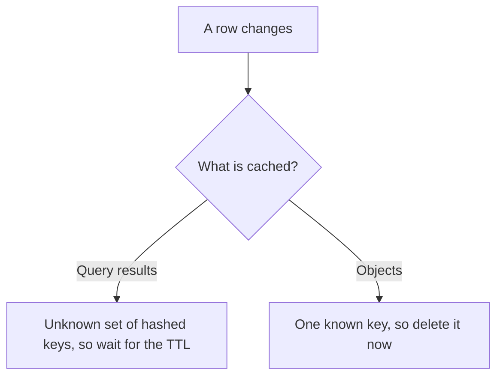

# What to Cache: Query Results vs Objects

> **TL;DR**: Deciding where a cache sits is only half the job. You also have to decide what goes in it. Caching raw query results is easy to add but hard to invalidate. Caching assembled objects takes a little more code, but gives you a clear thing to delete when data changes.

## Learning Objectives

After this module, you will be able to:

- [ ] Compare caching at the row, query, object and page level
- [ ] Explain why query-level caches are hard to invalidate
- [ ] Design object cache keys that are easy to invalidate
- [ ] Choose suitable data to cache

## Intuition

Imagine a librarian who keeps answers to questions. If every note is filed under the exact question, "books by Austin published before 1815", then correcting one book's date means finding every note that might mention it. If instead there is one card for each book, one correction fixes one card, and any answer can be rebuilt from the cards. Query caching is the first system and object caching is the second.

## Theory

### Levels of caching

The [caching lesson](03-caching.md) covers where a cache can sit. Within an application cache, you can store different kinds of value:

| Level | What is stored | Invalidating it | Good for |
|---|---|---|---|
| Row | One database row | Easy | Simple lookups by primary key |
| Query | The result of a query, keyed by its text | Hard | Expensive reports, slowly changing data |
| Object | An assembled entity, such as a user profile | Fairly easy | Most application data |
| Page or fragment | Rendered HTML or JSON | Medium | Pages that are mostly the same for everyone |

### Caching at the query level

Hash the query and its parameters to make a key, then store the result:

```python
key = "q:" + sha256(sql + repr(params))
rows = cache.get(key)
if rows is None:
    rows = db.execute(sql, params)
    cache.set(key, rows, ttl=60)
```

It takes little code, but one question has no good answer: **when a row changes, which keys should be deleted?** The key is a hash, so nothing links it to the rows that produced it. A single changed cell could affect any number of cached queries.

That usually leaves a short TTL and accepting stale results until it expires. This is fine for a dashboard refreshed every minute, and a poor fit for data where a user expects to see their own change immediately.

### Caching at the object level

Treat the data as your application does, as objects assembled from one or more tables:

```python
def get_profile(user_id):
    key = f"profile:v3:{user_id}"
    profile = cache.get(key)
    if profile is None:
        profile = build_profile(user_id)  # may read several tables
        cache.set(key, profile, ttl=3600)
    return profile

def update_user(user_id, changes):
    db.update_user(user_id, changes)
    cache.delete(f"profile:v3:{user_id}")
```

The key names the thing it holds, so a change to a user means deleting one known key.



*Object keys record what they contain, which is what makes targeted invalidation possible.*

Other advantages:

- **Reuse.** One cached profile serves many pages and queries.
- **Background refresh.** Workers can rebuild an object and overwrite the cached copy, so readers never wait on an expensive build.
- **Easy format changes.** The `v3` in the key lets you change the object's shape, since new code simply reads new keys and old ones expire.

Objects that depend on many others remain tricky. If a team's cached page lists member names, renaming a member has to clear that too. Cache the IDs and look up each member separately, or use a short TTL.

### What to cache

Good candidates are read often, costly to build and tolerant of slight staleness:

- User sessions
- Rendered pages for logged-out visitors
- Activity feeds
- Social graph data such as friend lists
- Counts and aggregates

Be careful with permissions, account balances, or anything where a stale value causes real harm. Never mix personalized data into a shared cache without including the user in the key.

### Keep the cache shared

Avoid storing cached values in local files on application servers. New servers start empty, and each server can hold a different answer, which makes scaling and debugging harder. A shared store such as Redis or Memcached avoids both. A small in-process cache on top is fine for rarely changing data, as long as its TTL is short.

### Choosing between Redis and Memcached

Both are in-memory key-value stores. Memcached is simple and multithreaded, suiting plain object caching. Redis adds data structures such as sorted sets and lists, and optional persistence, which suits leaderboards and feeds. Persistence does not make a cache a database, so your system must still work when a key is missing.

## Real-World Example

A store's product page calls a costly query that joins products, prices, inventory and reviews. The first version caches the query result, which leaves stale prices on screen until the TTL expires. The team then caches each `product:{id}` object, and deletes it when the admin tool saves a change. Inventory changes so often that it is split out with a 30-second TTL. Reviews, which rarely change, get a long TTL. Each kind of data now has a freshness rule that fits it.

## Trade-offs

| Approach | Benefit | Cost |
|---|---|---|
| Query caching | Can be added without changing the design | Hard to invalidate, so data stays stale until the TTL |
| Object caching | Targeted invalidation and reuse | More code, and you must find every write path |
| Page caching | Saves the most work per hit | Hard to personalize, with many variants to store |

## Common Pitfalls

> **Missing a write path.** If a batch job updates users without deleting the key, the cache stays stale. Keep writes in one module, or invalidate from a change data capture stream.

> **Caching personalized data under a shared key.** One user can then see another user's data, which is a serious privacy bug. Include the user in the key, or do not cache it.

> **Deleting before writing.** If you delete the key and then update the database, a concurrent read can put the old value straight back. Update first, then delete, and keep a TTL as a safety net.

> **Building objects too large.** A huge cached object wastes bandwidth when you need one field. Split it along how it is used.

## Exercise

A forum shows threads with a title, author name, reply count and the latest five replies. Decide what to cache and what to invalidate when a user renames themselves or someone posts a reply.

<details>
<summary><strong>Solution sketch</strong></summary>

Cache `thread:{id}` with the title and author ID, `user:{id}` with the name, and `thread_replies:{id}` with the latest reply IDs, plus a separate counter for the reply count. Fetch the names with a multi-get. A rename then clears just one `user:{id}` key rather than every thread. A new reply updates the counter and clears `thread_replies:{id}`. Keeping IDs instead of names inside objects is what makes this cheap.

</details>

## Key Takeaways

- Query caches are quick to add, but hard to invalidate, so they depend on short TTLs.
- Object caches use meaningful keys, so a change clears exactly what it affects.
- Store IDs inside objects rather than copies of other objects where you can.
- Pick a freshness rule for each kind of data, and never mix users in a shared key.
- Use a shared cache instead of local files, and make sure the system works without any given key.

## Further Reading

- [Caching](03-caching.md) covers the cache hierarchy, patterns and eviction.
- [Cache strategies](../trade-offs/06-cache-strategies.md) compares cache-aside, write-through and others.
- [Design a search query cache](../part-8-case-studies/59-search-query-cache.md) applies this to a query-level cache where it fits well.

## Flashcards

**Q:** Why are query-level caches hard to invalidate?
**A:** Keys are hashes of queries, so nothing tells you which cached results contain a changed row.

**Q:** Why are object caches easier to invalidate?
**A:** The key names the entity, so a change to it means deleting one known key.

**Q:** How can a key make format changes safe?
**A:** Add a version, such as `profile:v3:42`, so new code reads new keys while old ones expire.

**Q:** Why avoid file-based caches on application servers?
**A:** New servers start empty and each can hold different values, which makes scaling and debugging harder.

**Q:** When is query-level caching a reasonable choice?
**A:** For expensive results that can be slightly stale, such as dashboards, or for search results where the query itself is the natural key.

**Q:** In what order should you write and invalidate?
**A:** Update the database, then delete the key, with a TTL as a safety net. Deleting first lets a concurrent read restore the old value.

## References

- Donne Martin, "Cache," The System Design Primer. https://github.com/donnemartin/system-design-primer#cache
- Redis documentation, "Understand Redis data types." https://redis.io/docs/latest/develop/data-types/
