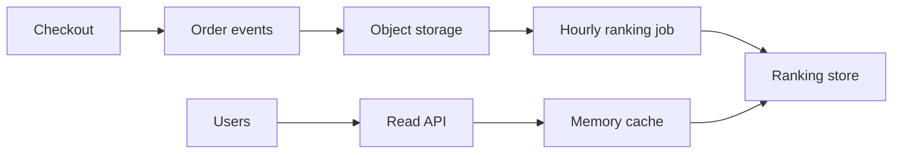
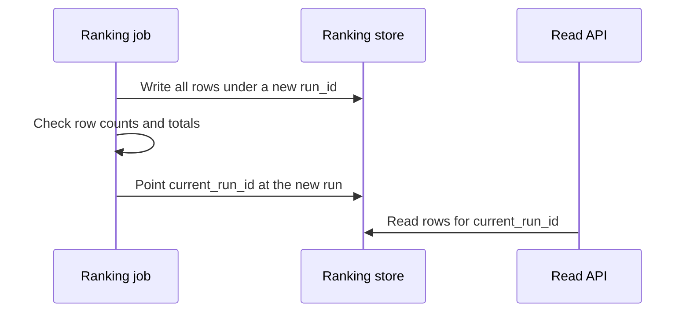

# Design a Sales Ranking by Category

> **TL;DR.** Do not calculate rankings when a page loads. Record every order as an event, recompute the top products hourly with a batch job, and serve the finished lists from a store built for reads. Readers never touch the raw data, and a failed job just means rankings stay an hour old.

## Learning Objectives

- [ ] Separate the path that computes rankings from the path that serves them
- [ ] Estimate storage and traffic from the requirements
- [ ] Design a batch job with a rolling time window
- [ ] Swap in new results without readers seeing a half-finished list

## Intuition

A music chart is not worked out each time someone looks at it. Sales are collected, the chart is compiled once in a while, and the finished chart is printed for anyone to read. Lots of readers, few compilers, and nobody minds that it was compiled an hour ago.

## Requirements

**Functional**

- Calculate the best-selling products by category over the past 7 days.
- Show a category's ranking to users.

**Non-functional**

- High availability for reads.
- Rankings refresh hourly.
- Products can belong to more than one category. There are no subcategories.

**Assumptions:** 10 million products, 1,000 categories, 1 billion orders a month, 100 billion ranking reads a month.

## Capacity Estimation

A month has about 2.5 million seconds, which keeps the arithmetic simple.

| Quantity | Calculation | Result |
|---|---|---|
| Write rate | 1 billion / 2.5 million | 400 per second on average |
| Read rate | 100 billion / 2.5 million | 40,000 per second on average |
| Event size | Timestamp, IDs, quantity and price | About 40 bytes |
| New data | 40 bytes x 1 billion | 40 GB per month, about 1.44 TB in 3 years |

A 100:1 read to write ratio, plus data that is an hour stale by design, points strongly to precomputing and caching.

## API and Data Model

```http
GET /api/v1/categories/{category_id}/top-products?limit=100
```

```json
{
  "category_id": 1234,
  "computed_at": "2026-10-31T10:00:00Z",
  "products": [{ "rank": 1, "product_id": 42, "units_sold": 18230 }]
}
```

```sql
CREATE TABLE sales_rank (
  run_id      BIGINT  NOT NULL,
  category_id INT     NOT NULL,
  rank        INT     NOT NULL,
  product_id  BIGINT  NOT NULL,
  units_sold  BIGINT  NOT NULL,
  PRIMARY KEY (run_id, category_id, rank)
);
```

Returning `computed_at` lets the page be honest about how fresh the list is.

## High-Level Architecture



*The write and read paths only meet at the ranking store, so one can fail without taking down the other.*

## Deep Dives

### The ranking job

The job scans the last 7 days of events and works in three steps:

1. **Join and expand.** Attach each product's categories, so one order line produces one row per category.
2. **Sum.** Group by `(category_id, product_id)` and add up the quantities.
3. **Rank.** Within each category, keep the top N.

```python
ranked = (
    orders.filter(col("created_at") >= now - timedelta(days=7))
    .join(product_categories, "product_id")
    .groupBy("category_id", "product_id")
    .agg(sum("quantity").alias("units_sold"))
    .withColumn("rank", row_number().over(
        Window.partitionBy("category_id").orderBy(desc("units_sold"), "product_id")))
    .filter(col("rank") <= 100)
)
```

The `product_id` tie-break keeps the order stable between runs, so tied products do not swap places for no reason.

### Rolling windows without rescanning everything

Reading 7 days of data every hour repeats a lot of work. Instead, summarize each finished hour once into `(hour, category, product, units)`. Each run then adds up 168 hourly summaries, and old ones simply drop out of the window.

### Publishing safely

A reader should never see a half-written ranking:



*Because the switch is a single update, readers get either the old run or the new one, and rolling back is just as simple.*

Checks before the switch catch bad runs. If a run has far fewer rows than the last one, keep serving the old results and raise an alert.

### Serving reads

40,000 reads per second across just 1,000 lists is an ideal caching case, with traffic concentrated on the popular categories. Put a memory cache in front of the store, with a key that includes the run, such as `rank:{run_id}:{category_id}`. Publishing a new run then needs no invalidation. Requests just start using the new keys, and old ones expire. A small jitter on TTLs and a warm-up of top categories prevent a stampede when the switch happens.

## Trade-offs

| Decision | Benefit | Cost |
|---|---|---|
| Hourly batch | Simple, cheap and easy to rerun | Rankings can be up to an hour old |
| Stream processing | Near real-time rankings | More complicated, and few users would notice |
| Precomputed lists | Reads are fast and predictable | Only supports the queries you planned for |
| Object storage for events | Cheap, and history can be reprocessed | Not directly queryable by the site |

If hot items need fresher rankings, run a streaming job for only the busiest categories alongside the batch job.

## Scaling and Failure Modes

| Failure | Effect | Response |
|---|---|---|
| Ranking job fails | Rankings get stale | Keep serving the last good run, alert and rerun |
| Duplicate events | Inflated counts | Include an order ID and remove duplicates in the job |
| Cache loss | Load spike on the store | Replicas on the store, request coalescing |
| Late events | A slight undercount | Reprocess recent hours on each run |

## Common Pitfalls

> **Querying the orders database for rankings.** A week-long aggregation on the transactional database harms checkout. Keep analytics separate.

> **Overwriting results in place.** Readers see a mix of old and new. Write a new version, then switch to it.

> **Counting cancelled orders.** Rankings get inflated, or can be gamed. Decide how returns and fraud are handled, and record those events too.

## Exercise

Product managers want a "trending" list that favours products selling faster than last week. What changes?

<details>
<summary><strong>Solution sketch</strong></summary>

Compute two windows from the hourly summaries: the last 7 days and the 7 days before that. Score by growth with a minimum volume, such as `(this_week + k) / (last_week + k)`, so a product going from 1 sale to 3 does not win. Publish as a separate list using the same run-based switch. The serving path does not change.

</details>

## Key Takeaways

- Separate computing from serving when reads vastly outnumber writes and slight staleness is acceptable.
- Keep raw events in cheap storage, so results can be recomputed.
- Roll up finished hours so that a rolling window does not rescan everything.
- Publish by switching to a complete new version, which also makes rollback easy.
- Including the version in cache keys removes the need to invalidate.

## Further Reading

- [Stream vs batch](../part-4-data-systems/03-stream-vs-batch.md)
- [Design a leaderboard](26-leaderboard.md) covers rankings that must update instantly.
- [OLTP vs OLAP](../part-4-data-systems/01-oltp-vs-olap.md)

## Flashcards

**Q:** Why precompute sales rankings rather than calculating them on request?
**A:** Reads outnumber writes 100 to 1, slight staleness is fine, and aggregating a week of orders per request would be far too expensive.

**Q:** How do you avoid rescanning 7 days of data every hour?
**A:** Summarize each finished hour once, then add up the last 168 summaries.

**Q:** How can a new ranking go live safely?
**A:** Write it under a new run ID, validate it, then update a single pointer to that run. Rollback just moves the pointer back.

**Q:** Why include the run ID in cache keys?
**A:** A new run uses new keys automatically, so nothing needs to be invalidated.

**Q:** What should readers see if the job fails?
**A:** The last good ranking, with an alert going to the team.

## References

- Donne Martin, "Design Amazon's sales rank by category feature," The System Design Primer. https://github.com/donnemartin/system-design-primer/tree/master/solutions/system_design/sales_rank
