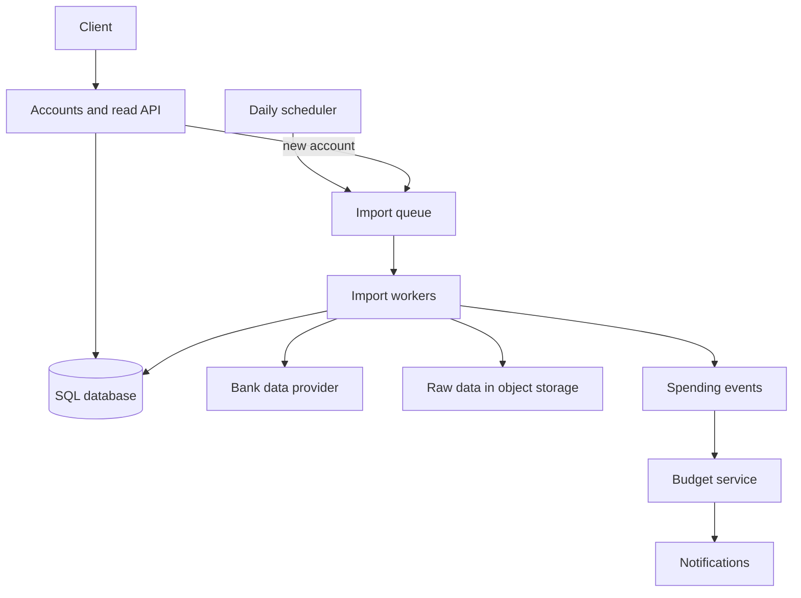

# Design a Personal Finance Aggregator

> **TL;DR.** Unusually for a consumer app, this system writes far more than it reads, because transactions keep arriving whether or not anyone opens the app. Import in the background through a queue, make imports safe to repeat, keep monthly totals ready for fast reading, and treat bank access as the most sensitive thing you hold.

## Learning Objectives

- [ ] Design a write-heavy background import pipeline
- [ ] Make repeated imports safe using deduplication
- [ ] Precompute monthly spending for fast reads
- [ ] Protect tokens and financial data

## Intuition

Picture a bookkeeper who visits your banks each morning, copies new statements, files each line under a heading and leaves a monthly summary on your desk. Most days you never look. The bookkeeper needs to work steadily whether or not you do, and must never lose or double-count a line. They also hold the keys to your accounts, so those keys need guarding.

## Requirements

**Functional**

- Link a financial account.
- Import new transactions daily, for users active in the past 30 days.
- Categorize transactions automatically, and let users override the category.
- Analyze monthly spending by category.
- Recommend a budget, let users set their own, and notify them when near or over budget.

**Non-functional**

- High availability.
- Transactions must not be lost or duplicated.
- Budget notifications do not need to be instant.

**Assumptions:** 10 million users, 30 million accounts, 5 billion transactions a month, 500 million reads a month.

## Capacity Estimation

| Quantity | Calculation | Result |
|---|---|---|
| Write rate | 5 billion / 2.5 million seconds | 2,000 per second on average |
| Read rate | 500 million / 2.5 million seconds | 200 per second on average |
| Transaction size | User ID, time, seller, amount | About 50 bytes |
| New data | 50 bytes x 5 billion | 250 GB per month, 9 TB in 3 years |

The 10:1 write to read ratio shapes the design. A single database will struggle with this over time, so plan for how the transactions table will be partitioned.

## API and Data Model

```http
POST /api/v1/accounts            {"provider_token": "..."}
GET  /api/v1/spending?month=2026-10
PUT  /api/v1/transactions/{id}/category  {"category": "groceries"}
PUT  /api/v1/budgets/{category}  {"monthly_limit": "200.00"}
```

```sql
CREATE TABLE transactions (
  id             BIGINT PRIMARY KEY,
  user_id        BIGINT NOT NULL,
  account_id     BIGINT NOT NULL,
  provider_txn_id TEXT  NOT NULL,
  posted_at      TIMESTAMPTZ NOT NULL,
  seller         TEXT NOT NULL,
  amount         DECIMAL(12, 2) NOT NULL,
  category       TEXT NOT NULL,
  category_source TEXT NOT NULL, -- 'auto' or 'user'
  UNIQUE (account_id, provider_txn_id)
);

CREATE TABLE monthly_spending (
  user_id  BIGINT NOT NULL,
  month    DATE   NOT NULL,
  category TEXT   NOT NULL,
  total    DECIMAL(14, 2) NOT NULL,
  PRIMARY KEY (user_id, month, category)
);
```

Amounts use `DECIMAL` because floating point cannot represent many money values exactly.

## High-Level Architecture



*Imports run in the background, so a slow bank provider never affects the people using the app.*

## Deep Dives

### Importing transactions

The scheduler enqueues one task per account for users active in the past 30 days, which skips a large share of accounts. Each worker then:

1. Fetches new transactions from the data provider.
2. Saves the raw response to object storage, so a parser bug can be fixed and the data replayed.
3. Parses and categorizes them.
4. Inserts them, updates monthly totals and emits events.

Spreading the schedule over the day, rather than starting everything at midnight, keeps you within providers' rate limits. Limit concurrency per provider, so a failing bank does not use up every worker.

### Making imports repeatable

Tasks run at least once and providers return overlapping date ranges, so duplicates are certain to arrive. The unique constraint makes repeats harmless:

```sql
INSERT INTO transactions (...) VALUES (...)
ON CONFLICT (account_id, provider_txn_id) DO NOTHING;
```

Update the monthly total in the same database transaction as the insert, and only for rows actually inserted. Pending transactions often change ID or amount when they post, so check how your provider reports them.

### Categorizing transactions

Start with a lookup from seller to category. With about 50,000 sellers, that table fits comfortably in memory. Seller text from banks is messy, so normalize it first by removing store numbers and payment prefixes. Later, a model can handle sellers that are not in the table.

A user override always wins. Storing `category_source` means later re-categorization never overwrites a choice the user made. When a user changes a category, adjust both monthly totals in one transaction.

### Budgets and notifications

Notifications need not be instant, so a service consumes spending events and compares monthly totals with budgets. Remember what has been sent for each user, category and month, so a retry does not send a duplicate alert. Recommended budgets can come from a batch job that looks at recent months of spending.

### Security

This system holds both the access to financial accounts and a detailed record of people's lives, so security shapes the design.

- **Never store bank passwords.** Use an aggregator or open banking API that issues tokens, ideally with read-only scopes.
- **Encrypt tokens separately** with a key management service, with access limited to import workers.
- **Encrypt data in transit and at rest**, limit staff access and audit it.
- **Keep sensitive data out of logs.**
- **Support account deletion**, including tokens and raw files, and check rules such as GDPR for your market.

## Trade-offs

| Decision | Benefit | Cost |
|---|---|---|
| Queue-based imports | Absorbs provider slowness and failures | Data is a little behind |
| Precomputed monthly totals | Fast dashboards | Must be kept in sync with transactions |
| Raw data kept in object storage | Can replay after a bug | Extra sensitive data to protect and delete |
| Skipping inactive users | Much lower import cost | A delay catching up when they return |

## Scaling and Failure Modes

| Failure | Effect | Response |
|---|---|---|
| Provider outage | Imports stall for that bank | Back off, keep other banks running, show last-updated time |
| Bank token expires | Account stops updating | Notify the user to reconnect |
| Parser bug | Bad data is stored | Fix it, then replay from raw files |
| Database growing too large | Slower writes | Partition by month, shard by user, archive old data |

Partitioning by month keeps recent data fast, and most reads concern recent months. Sharding by `user_id` works well later, because almost all queries are for a single user.

## Common Pitfalls

> **Importing on page load.** The user waits on a third party, and your read path now depends on theirs. Import in the background and show the last-updated time.

> **Storing bank credentials.** A breach becomes a catastrophe. Use token-based access.

> **Recomputing totals on every read.** Summing a year's transactions per dashboard load gets expensive. Keep rollups, and reconcile them with a periodic job.

> **Using floats for money.** Rounding errors add up. Use decimals or integer minor units.

## Exercise

A provider corrects last month's transactions, changing some amounts and removing others. How does your design handle this, and how would users know?

<details>
<summary><strong>Solution sketch</strong></summary>

Import a rolling window that overlaps recent days, and use an upsert rather than `DO NOTHING` when the provider's version has changed. Mark removed transactions as deleted, so there is a history. Recalculate the affected monthly totals for that user, and rerun the budget check. Show a small note on changed data, and consider suppressing an alert if the correction was small.

</details>

## Key Takeaways

- Work out the read and write ratio first: this app is write-heavy, even though it looks like a dashboard.
- Run imports in the background, with per-provider limits.
- Uniqueness constraints turn duplicate imports into harmless repeats.
- Rollups keep dashboards fast, and raw data makes recovery possible.
- Bank access deserves the strongest protection, so never store passwords.

## Further Reading

- [Task queues](../part-2-building-blocks/17-task-queues-background-jobs.md)
- [Idempotency and exactly-once](../part-3-distributed-systems-theory/07-idempotency-exactly-once.md)
- [Design a payment system](19-payment-system.md)

## Flashcards

**Q:** Why is a finance aggregator write-heavy?
**A:** Transactions arrive every day regardless of whether users visit, and many users only check in occasionally.

**Q:** How do you stop duplicate transactions?
**A:** A unique constraint on the account and the provider's transaction ID, with inserts that ignore conflicts.

**Q:** Why keep raw provider responses?
**A:** After a parser or categorization bug, the data can be reprocessed without fetching it again.

**Q:** How do you stop automatic categorization overwriting a user's choice?
**A:** Store the source of each category, and never change one marked as set by the user.

**Q:** Why avoid storing bank passwords?
**A:** A breach would expose full account access. Token-based APIs allow limited, revocable access.

## References

- Donne Martin, "Design Mint.com," The System Design Primer. https://github.com/donnemartin/system-design-primer/tree/master/solutions/system_design/mint
