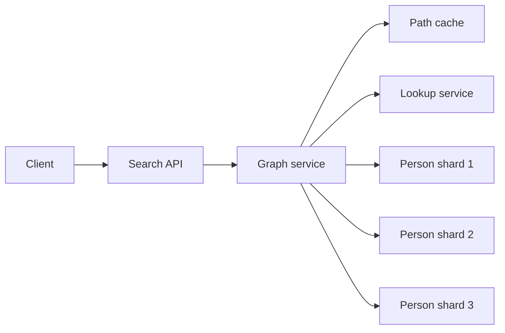

# Design a Social Graph Search

> **TL;DR.** Breadth-first search finds the shortest path, but on a graph spread across many servers each hop becomes a network call and the search area explodes. Batch lookups by shard, search from both ends at once, limit the depth, and cache what you can.

## Learning Objectives

- [ ] Store a large graph as adjacency lists across shards
- [ ] Explain why a naive distributed BFS is too slow
- [ ] Use bidirectional search to cut the work dramatically
- [ ] Choose suitable limits and caching for path queries

## Intuition

You want to reach someone through friends of friends. Asking everyone you know, then everyone they know, soon means thousands of phone calls. It is much quicker if the target also starts asking outward, and you stop when the two groups find someone in common. Each side only has to go about halfway.

## Requirements

**Functional**

- A user searches for someone and sees the shortest chain of friends connecting them.

**Non-functional**

- High availability.
- Traffic is uneven, with some searches repeated often.
- The graph does not fit on one machine.

**Assumptions:** 100 million users, 50 friends each on average, 1 billion searches a month. Edges are unweighted. As an exercise in fundamentals, use general-purpose storage rather than a dedicated graph database.

## Capacity Estimation

| Quantity | Calculation | Result |
|---|---|---|
| Friend list entries | 100 million x 50 | 5 billion |
| Adjacency storage | 5 billion x 8 byte IDs | About 40 GB, before overhead |
| Search rate | 1 billion / 2.5 million seconds | 400 per second on average |

The raw adjacency data is smaller than you might expect, so it may not be size that forces sharding. Sharding lets you handle the traffic, and keep the lists in memory.

The search area is the real challenge. With 50 friends each, one-directional BFS can reach:

| Hops | People reached (upper bound) |
|---|---|
| 1 | 50 |
| 2 | 2,500 |
| 3 | 125,000 |
| 4 | 6,250,000 |

Real networks overlap, so actual counts are lower, but the growth is what matters.

## API and Data Model

```http
GET /api/v1/connections/path?from=123&to=456&max_hops=4
```

```json
{ "path": [123, 87, 912, 456], "hops": 3 }
```

Each person's record is an adjacency list:

```text
person:123 -> { name, friend_ids: [87, 412, 950, ...] }
```

## High-Level Architecture



*The graph service runs the search, and the lookup service tells it which shard holds each person.*

## Deep Dives

### Sharding people

Hash the user ID to choose a shard, either by calculating it or through a small lookup service:

```python
def shard_for(person_id):
    return person_id % NUM_SHARDS  # use consistent hashing in production
```

[Consistent hashing](../part-3-distributed-systems-theory/09-consistent-hashing.md) avoids moving most people when shards are added. Each friendship is stored on both people's lists, so a read only touches one person's shard. Adding a friendship then writes to two shards, which needs a retry or an outbox so the lists do not drift apart.

### The problem with a basic search

A textbook BFS fetches one person at a time:

```python
from collections import deque

def shortest_path(source, target):
    queue = deque([source])
    parent = {source: None}
    while queue:
        person = queue.popleft()
        if person == target:
            return build_path(parent, target)
        for friend in get_friends(person):  # a network call per person
            if friend not in parent:
                parent[friend] = person
                queue.append(friend)
```

At three hops that can mean 125,000 network calls for one search. Two changes fix most of this.

### Batching by shard

Search one level at a time. Group that level's people by shard and make one request to each shard, rather than one per person:

```python
def expand(level):
    by_shard = group_by(level, shard_for)
    responses = parallel(fetch_friends(shard, ids) for shard, ids in by_shard.items())
    return merge(responses)
```

The number of calls per level now depends on the number of shards, not the number of people.

### Searching from both ends

Run the search from both people, always expanding the smaller side, and stop when the two sides meet.


*Two small searches replace one enormous one.*

For a path of 4 hops, each side goes 2 hops, reaching about 2,500 people on each side, rather than up to 6.25 million one way. For precise shortest paths, stop only after finishing the level where the sides first meet, and check for any shorter joined path.

### Limits and caching

- **Limit the depth.** A `max_hops` of 3 or 4 fits how a feature such as "how you're connected" is used, and past that the answer is rarely interesting.
- **Set a time budget.** If it runs out, return "no close connection found" instead of waiting.
- **Watch out for very popular accounts.** Someone with millions of connections makes one expansion huge. Cap how many friends you expand, or skip them, and accept a result that may not be the very shortest.
- **Cache results.** Keep popular paths with a TTL. A slightly old path is usually fine, as long as you check a friendship has not ended before showing it.
- **Precompute nearby people.** Storing each user's 2-hop neighbourhood makes common queries fast, but costs a lot of storage and refresh work. Consider it for active users only.

### Privacy

A person may hide their friend list, or block someone. Check these rules when showing a path, and remember that even proving a connection exists can reveal private information.

## Trade-offs

| Decision | Benefit | Cost |
|---|---|---|
| Hash sharding | Even load, simple routing | Friends land on different shards, so searches touch many |
| Sharding by location | Friends are more likely to be on the same shard | Uneven load, and people move |
| Bidirectional search | Enormously less work | More complicated, with both ends needed |
| Depth and time limits | Predictable latency | Some distant paths are not found |
| Graph database | Traversal is built in | Another system to run, and sharding remains hard |

## Scaling and Failure Modes

| Failure | Effect | Response |
|---|---|---|
| Shard down | Missing friend lists | Replicas, or a partial result with a warning |
| Popular account expansion | Slow searches | Cap the expansion and the time budget |
| Stale cached path | Shows a friendship that ended | Short TTL, and check edges before display |
| Traffic spike on one search | Repeated expensive work | Cache it and coalesce identical requests |

## Common Pitfalls

> **Fetching one person at a time over the network.** It is correct and works on small tests, then collapses at scale. Batch by level and shard.

> **No limits.** A single search across a connected graph could touch a huge share of your data. Always set a depth and time limit.

> **Forgetting the cycle check.** Without a visited set, a search keeps revisiting the same people in a graph full of cycles.

> **Ignoring privacy.** A path can reveal friendships someone chose to hide.

## Exercise

Add a "people you may know" feature that ranks friends of friends by the number of mutual friends. Should it run during the request or ahead of time?

<details>
<summary><strong>Solution sketch</strong></summary>

Compute it ahead of time. Requesting two hops for each user is costly, and the results change slowly. A batch job counts mutual friends for each user's second-hop candidates, removes existing friends and blocked users, and stores the top results in a key-value store. The API reads that list and filters it once more. Skip or cap very popular accounts, because they are mutual friends of nearly everyone and say little.

</details>

## Key Takeaways

- Each hop multiplies the search area, so a plain BFS on a sharded graph is too slow.
- Batching by shard cuts network calls, while bidirectional search cuts the people visited.
- Depth limits and time budgets keep latency predictable.
- Popular accounts need special handling.
- A graph database is an option, but its traversals are subject to the same physics once data spans machines.

## Further Reading

- [Graph databases](../part-4-data-systems/07-graph-databases.md)
- [Consistent hashing](../part-3-distributed-systems-theory/09-consistent-hashing.md)
- [Database partitioning and sharding](../part-2-building-blocks/06-database-partitioning-sharding.md)

## Flashcards

**Q:** How does a BFS guarantee the shortest path in an unweighted graph?
**A:** It explores people in order of distance, so the first time it reaches the target is by a shortest route.

**Q:** Why does bidirectional search help so much?
**A:** Each side only explores about half the path, and the work grows exponentially with depth. A 4-hop path needs about 2,500 people per side instead of up to 6.25 million.

**Q:** How do you cut network calls in a distributed BFS?
**A:** Process one level at a time and batch requests per shard.

**Q:** Why do very popular accounts cause problems?
**A:** Expanding one means processing millions of connections, so searches cap or skip them.

**Q:** Why are depth limits reasonable here?
**A:** Search cost grows quickly, and distant connections are rarely useful to the user.

## References

- Donne Martin, "Design the data structures for a social network," The System Design Primer. https://github.com/donnemartin/system-design-primer/tree/master/solutions/system_design/social_graph
