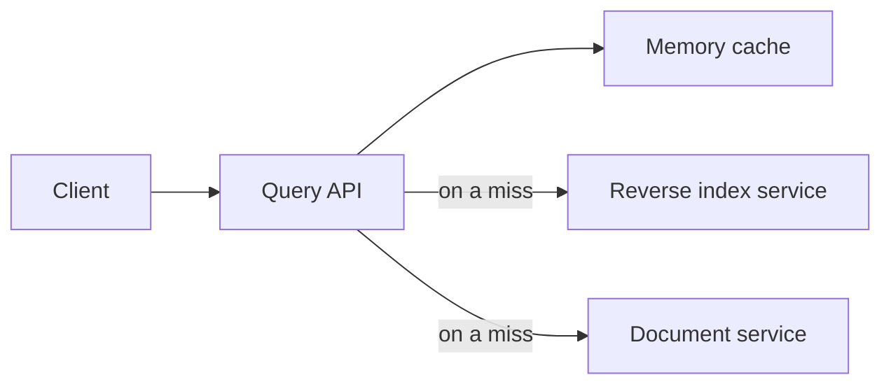
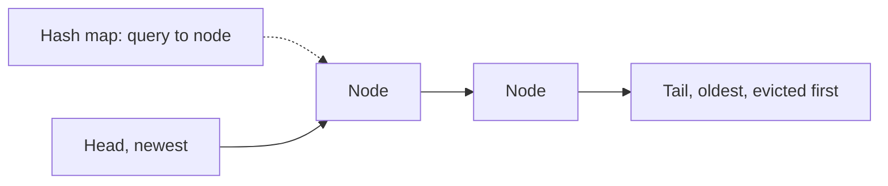
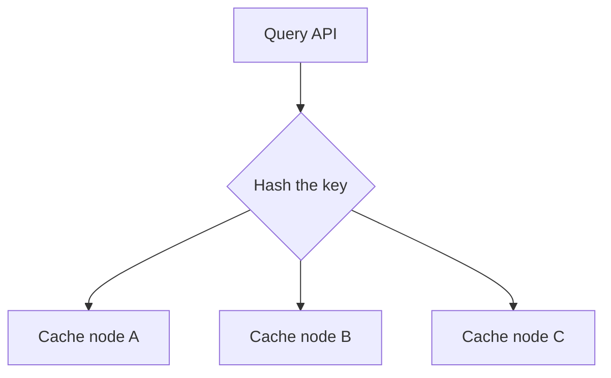

# Design a Search Query Cache

> **TL;DR.** Search traffic is very uneven, so a small cache of popular queries avoids most of the expensive index work. Normalize queries so that equal searches share a key, evict with LRU using a hash map and a linked list, and shard the cache by query once it outgrows one machine.

## Learning Objectives

- [ ] Estimate cache size from traffic
- [ ] Normalize queries to raise the hit rate
- [ ] Implement an LRU cache with O(1) reads and writes
- [ ] Decide how to expire results and scale the cache across machines

## Intuition

A reference librarian who keeps the most recent answers on a desk can respond instantly to the questions people ask again and again, and only goes to the stacks for unusual ones. The desk is small, so when it is full, the note that has gone unused the longest gets thrown away.

## Requirements

**Functional**

- A search that hits the cache returns stored results.
- A search that misses runs against the search services, then stores the results.

**Non-functional**

- Very low latency and high availability.
- Limited memory, so entries must be chosen and expired sensibly.

**Assumptions:** 10 million users, 10 billion queries a month. Popular queries should almost always be in the cache.

## Capacity Estimation

| Quantity | Calculation | Result |
|---|---|---|
| Request rate | 10 billion / 2.5 million seconds | 4,000 per second on average |
| Entry size | Query (50 bytes), title (20), snippet (200) | About 270 bytes per result line |
| Worst-case data | 270 bytes x 10 billion | 2.7 TB per month, if every query is unique |

Storing everything would be wasteful, since many queries are never repeated. Because popular queries take up most of the traffic, a much smaller cache can achieve a high hit rate. Note that a real result page holds several results, so multiply the entry size by your page size when sizing the cache.

## API and Data Model

```http
GET /api/v1/search?q=distributed+systems
```

```text
key:   hash of the normalized query
value: ordered list of { title, snippet, url }
```

## High-Level Architecture



*The cache sits between the query API and the expensive search services.*

## Deep Dives

### Normalizing queries

"Distributed Systems" and "distributed  systems" should reuse one entry, so clean queries before they become keys:

- Trim the text and collapse whitespace.
- Make it lowercase.
- Remove markup.
- Fix common typos, if the search service would treat them the same.
- Sort or standardize options such as filters.

Anything that changes the results must stay in the key, including language, region and page number. And if results are personalized, those personal factors belong in the key too, or the query should skip the shared cache.

### Implementing LRU

LRU needs two operations to be fast: finding an entry, and finding the entry unused for longest. A hash map does the first, and a doubly linked list does the second, with the newest at the head and the oldest at the tail.



*The map finds a node instantly, and the list lets it move to the head without searching.*

```python
class LRUCache:
    def __init__(self, capacity):
        self.capacity = capacity
        self.nodes = {}
        self.items = LinkedList()

    def get(self, query):
        node = self.nodes.get(query)
        if node is None:
            return None
        self.items.move_to_front(node)
        return node.results

    def set(self, query, results):
        node = self.nodes.get(query)
        if node is not None:
            node.results = results
            self.items.move_to_front(node)
            return
        if len(self.nodes) >= self.capacity:
            oldest = self.items.remove_from_tail()
            del self.nodes[oldest.query]
        self.nodes[query] = self.items.append_to_front(query, results)
```

Every operation is O(1). In production, you would generally use Redis with `maxmemory-policy allkeys-lru`, or Memcached, rather than writing your own. Redis approximates LRU by sampling keys, which saves memory and works nearly as well.

### Keeping results fresh

Results go stale when pages change or new ones appear. Three methods work together:

- **A TTL** on every entry sets the upper limit on staleness. Use a short TTL for news-like queries, which you can detect, and a longer one for others.
- **Targeted removal** is hard, since a changed page can appear in countless cached queries. Keep an index from document to queries only for your most important content.
- **Background refresh** of the most popular queries keeps them from ever expiring and causing a spike of misses.

### Stampedes

When a popular query expires, many requests can miss at once and all hit the index. Prevent it by letting one request rebuild the entry while others wait or get the stale copy. Adding a small random amount to each TTL stops many entries expiring together.

### Going beyond one machine



*Sharding by key sends each query to one node, so all its traffic can reuse one stored answer.*

- **Separate caches per server** are simple, but hit rates suffer because each holds its own copy.
- **A copy on every node** gives fast reads, but costs memory and makes updates complicated.
- **Sharding by key** is the usual choice. Use [consistent hashing](../part-3-distributed-systems-theory/09-consistent-hashing.md), so adding a node only moves a small share of keys.

A very hot query can overload one node, and a small local cache on each API server with a TTL of a few seconds handles that.

## Trade-offs

| Decision | Benefit | Cost |
|---|---|---|
| Aggressive normalization | Higher hit rate | Risks merging queries that should differ |
| Long TTL | Fewer misses | Staler results |
| LRU | Simple, and follows recent use | A burst of one-off queries can push out useful entries |
| Query-level caching | Fits, because the query is the natural key | Hard to remove entries when a document changes |

This is one place where [query-level caching](../part-2-building-blocks/20-caching-queries-vs-objects.md) fits well. The same question recurs often, and slight staleness is acceptable.

## Scaling and Failure Modes

| Failure | Effect | Response |
|---|---|---|
| Cache node lost | Misses for its keys, load on the index | Consistent hashing, replicas and rate limits on the index |
| Whole cache restarted cold | A big spike of index load | Warm the top queries and ramp up traffic gradually |
| Hot key | One node is overloaded | A short-lived local cache on API servers |
| Serving stale after an outage | Old results | Clear affected keys, or use versioned keys |

## Common Pitfalls

> **Caching without normalizing.** Small differences in text split one query into many entries, and the hit rate suffers.

> **Leaving filters out of the key.** Users get results for the wrong language or page. The key must include everything that changes the answer.

> **Treating the cache as required.** If search cannot survive cache failure, the cache has become a single point of failure. Limit how much load can reach the index during an outage.

> **Caching personalized results in a shared key.** One user's results can reach another. Add personal factors to the key, or skip the shared cache.

## Exercise

An LRU cache is being flooded by automated queries that never repeat, which push out useful results. How could you change it?

<details>
<summary><strong>Solution sketch</strong></summary>

Only admit a query to the cache after it has been seen before, using a small count or Bloom filter of recent queries. Alternatively, use an eviction policy that accounts for frequency as well as recency, such as Redis's LFU option, or keep new entries in a small probation area until they are requested again. Rate limiting the automated traffic also helps.

</details>

## Key Takeaways

- Uneven traffic means a small cache can absorb much of the load.
- Normalize queries, and include everything that affects results in the key.
- A hash map plus doubly linked list gives O(1) LRU, though you would normally use Redis or Memcached.
- Combine TTLs with refreshing of popular queries, and guard against stampedes.
- Shard by key using consistent hashing, and protect the index when the cache fails.

## Further Reading

- [Caching](../part-2-building-blocks/03-caching.md)
- [Design a distributed cache](16-distributed-cache.md)
- [Search systems](../part-4-data-systems/05-search-systems.md)

## Flashcards

**Q:** Which data structures make LRU O(1)?
**A:** A hash map to find entries and a doubly linked list to keep them in order of use.

**Q:** Why normalize search queries?
**A:** Equal searches written differently then share one cache entry, which raises the hit rate.

**Q:** What must a cache key include?
**A:** Everything that changes the answer, such as language, region, filters and page number.

**Q:** What is a cache stampede, and how do you prevent it?
**A:** Many requests miss together and overload the backend. Let one request rebuild the entry, and add jitter to TTLs.

**Q:** How can you handle a single very hot query?
**A:** Use a small local cache on API servers with a TTL of a few seconds.

## References

- Donne Martin, "Design a key-value cache to save the results of the most recent web server queries," The System Design Primer. https://github.com/donnemartin/system-design-primer/tree/master/solutions/system_design/query_cache
- Redis documentation, "Key eviction." https://redis.io/docs/latest/develop/reference/eviction/
