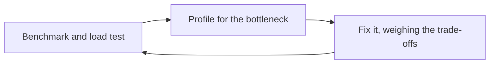
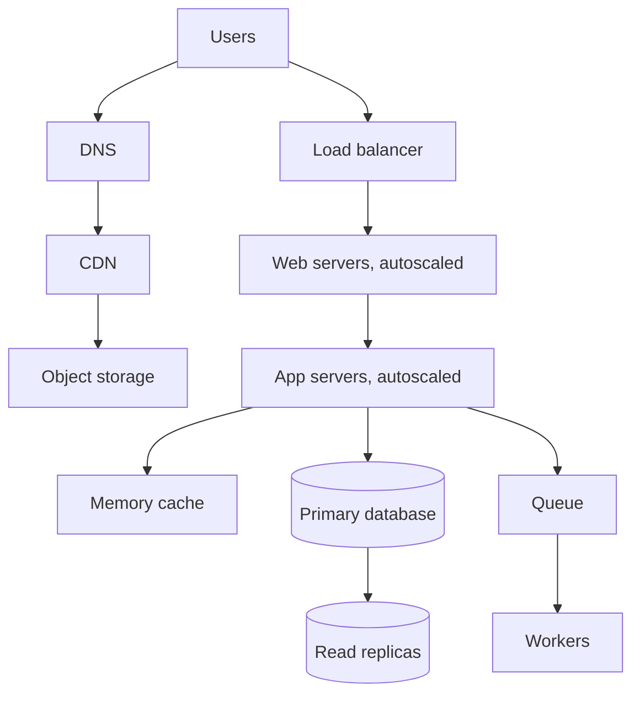

# Design a System That Scales to Millions of Users

> **TL;DR.** Nobody designs for millions on day one. Start with one server, measure, fix the current bottleneck, and repeat. Each stage below exists because something specific broke, so learn the reason for each step rather than just the final picture.

## Learning Objectives

- [ ] Follow the loop of benchmarking, profiling and fixing a bottleneck
- [ ] Explain what each stage of growth solves and what it costs
- [ ] Decide when to move static content, split tiers and add replicas
- [ ] Recognize when to add caches, autoscaling, sharding and NoSQL

## Intuition

A food stall does not begin as a chain. One cook does everything, then a helper takes orders when the queue gets long, then a second kitchen opens, then central suppliers. Each change answers a real problem. A chain's logistics would sink a stall on its first day.

## Requirements

**Functional**

- Users make read and write requests, and the service processes and stores data.
- The system grows from a handful of users to millions.

**Non-functional**

- High availability, relational data and uneven traffic.

**Target assumptions:** 10 million users, 1 billion writes a month, 100 billion reads a month, 1 KB per write.

## Capacity Estimation

| Quantity | Calculation | Result |
|---|---|---|
| Write rate | 1 billion / 2.5 million seconds | 400 per second on average |
| Read rate | 100 billion / 2.5 million seconds | 40,000 per second on average |
| New data | 1 KB x 1 billion | 1 TB per month, 36 TB in 3 years |

The 100:1 read to write ratio means reads will shape most decisions.

## The Scaling Loop

*Each stage below is one trip around this loop.*

Service names below are AWS examples, and every major cloud has equivalents.

## High-Level Architecture

This is where the stages end up.

*Every box was added to fix a bottleneck, and none of them should come before it is needed.*

## Deep Dives

### Stage 1: One server

A single virtual machine (EC2) runs the web server, the application and the database. It is easy to run and easy to change.

- **When it strains:** add memory or CPU by moving to a larger machine.
- **Add now:** basic monitoring of CPU, memory, disk and network, DNS with a stable address, and automated backups.
- **Risk:** this one machine is a single point of failure.

### Stage 2: Separate the database

The database and app compete for memory and disk, so move the database to its own server, ideally a managed service (RDS). Backups, patches and failover become easier. Each can now be sized separately. Keep it in a private network that the public internet cannot reach.

### Stage 3: Move static files and add a CDN

Images and uploads fill the disk and tie up the server. Move them to object storage (S3), then serve them through a CDN (CloudFront). The server only has to handle dynamic requests, and users far away get faster downloads. A [pull CDN](../trade-offs/23-push-vs-pull-cdn.md) is usually the right start.

### Stage 4: Multiple stateless servers

The app server is now the bottleneck, and is still a single point of failure.

- Put a **load balancer** in front of several servers across availability zones.
- Move sessions out of server memory and into a shared store, so any server can handle any request. See [stateless services](../part-1-core-fundamentals/00-scalability.md).
- Terminate TLS at the load balancer.
- If needed, separate web and application tiers, since they need different resources and can then scale separately.

Automate how servers are built, because hand-configured servers soon drift apart.

### Stage 5: Add database replicas

Reads are overwhelming the database. With a 100:1 ratio, adding read replicas helps a lot.

- Run a standby in another availability zone for failover, and send reads to [replicas](../part-2-building-blocks/07-database-replication.md).
- Watch for replication lag. After writing, a user might read an older value from a replica, so send read-your-own-writes queries to the primary.

### Stage 6: Add a cache

Replicas are expensive for the same repeated reads. Put a [memory cache](../part-2-building-blocks/20-caching-queries-vs-objects.md) (Redis or Memcached) in front of the database for popular objects and sessions. With traffic concentrated on a small share of data, this can remove a large portion of the database's reads.

### Stage 7: Autoscaling and better visibility

Traffic varies, and paying for peak capacity all day wastes money.

- **Autoscale** web and application servers on CPU, or better, on request rate or queue depth.
- Add **structured logs, metrics, traces and alerts**, because you can no longer log into one server to investigate.
- **Automate deployments** and roll out gradually, so one bad release does not hit everyone.

### Stage 8: Move slow work out of the request

Sending emails or processing images inside a request ties up servers. Use [task queues](../part-2-building-blocks/17-task-queues-background-jobs.md) and scale workers based on queue depth.

### Stage 9: Scaling writes and data

Eventually writes or data size become the limit. By now you have many options, which should be used in this order:

1. [Tune queries and indexes](../part-2-building-blocks/19-sql-tuning.md), and archive old data to a warehouse.
2. [Federate](../part-2-building-blocks/18-database-federation.md) by moving separate functions to their own databases.
3. [Shard](../part-2-building-blocks/06-database-partitioning-sharding.md) the tables that still dominate.
4. Move suitable workloads to [NoSQL](../part-2-building-blocks/05-nosql-databases.md), for example very large, simple key lookups or high-volume event data.

Each adds lasting complexity, which is why they come last.

## Trade-offs

| Stage | Solves | Adds |
|---|---|---|
| Separate database | Resource competition | A network hop, a second machine |
| CDN and object storage | Disk and bandwidth pressure | Cache invalidation |
| Load balancer and stateless servers | App capacity, server failure | A shared session store, deployment complexity |
| Read replicas | Read load | Replication lag |
| Cache | Repeated reads | Staleness, invalidation |
| Queues and workers | Slow work in requests | Eventual results, idempotency |
| Federation and sharding | Write and data limits | Lost joins, harder operations |

## Scaling and Failure Modes

| Failure | Effect | Response |
|---|---|---|
| A web server dies | A brief blip | The load balancer removes it, and autoscaling replaces it |
| Availability zone lost | Reduced capacity | Run in several zones, with spare capacity |
| Primary database dies | Writes stop briefly | Automatic failover to the standby |
| Cache cluster lost | Heavy load on the database | Limit and shed load, warm popular keys gradually |
| Bad deployment | Errors for users | Gradual rollout and fast rollback |

## Common Pitfalls

> **Starting with the final diagram.** Microservices and sharding on day one slow a small team down, and solve problems it does not have.

> **Scaling without measuring.** Adding servers does nothing if the database is the bottleneck.

> **Keeping state on web servers.** Sessions or uploads stored locally break as soon as a load balancer is added.

> **Autoscaling something that depends on a fixed resource.** Doubling app servers can double database connections and take the database down. Use connection pooling and limits.

> **Never testing failover.** A standby you have not tried may not work when it is needed.

## Exercise

Your app has one app server, one database, and 50,000 daily users. Pages are getting slow in the evenings. Profiling shows the database at 90% CPU, mostly reads, and the app server at 30%. What is your next step, and what would you skip for now?

<strong>Solution sketch</strong>

Look at the top queries first, since a missing index may solve the problem for free. Then add a cache for repeated reads, or a read replica, while being careful about stale reads. Move static files to a CDN if that is not done yet. Add a second app server and a load balancer for availability, not for capacity, since the app server has headroom. Skip sharding, microservices and NoSQL, because none of them address a problem the measurements show.

## Key Takeaways

- Scale by repeating a loop: measure, find the bottleneck, fix it.
- Make servers stateless before adding more of them.
- With read-heavy traffic, use CDNs, caches and replicas first.
- Move slow work to queues, and automate deployments and monitoring as you grow.
- Federation, sharding and NoSQL are powerful, but they cost the most, so use them last.

## Further Reading

- [Scalability](../part-1-core-fundamentals/00-scalability.md)
- [Vertical vs horizontal scaling](../trade-offs/20-vertical-vs-horizontal-scaling.md)
- [How to approach design questions](../part-1-core-fundamentals/05-how-to-approach-design-questions.md)

## Flashcards

**Q:** What is the core loop for scaling a system?
**A:** Benchmark and load test, profile for the bottleneck, fix it while weighing trade-offs, and repeat.

**Q:** Why move sessions off web servers before adding more servers?
**A:** Any server must be able to handle any request, and otherwise users lose their sessions as they move between servers.

**Q:** What does separating the database from the app server achieve?
**A:** It removes competition for resources, and lets each be sized and managed on its own.

**Q:** What risk do read replicas add?
**A:** Replication lag. A user may read old data just after writing, so send those reads to the primary.

**Q:** Why can autoscaling app servers overload a database?
**A:** More servers open more database connections. Use connection pooling and limits.

**Q:** In what order should you try to scale writes?
**A:** Tune and archive first, then federate, then shard, and move suitable workloads to NoSQL.

## References

- Donne Martin, "Design a system that scales to millions of users on AWS," The System Design Primer. https://github.com/donnemartin/system-design-primer/tree/master/solutions/system_design/scaling_aws
