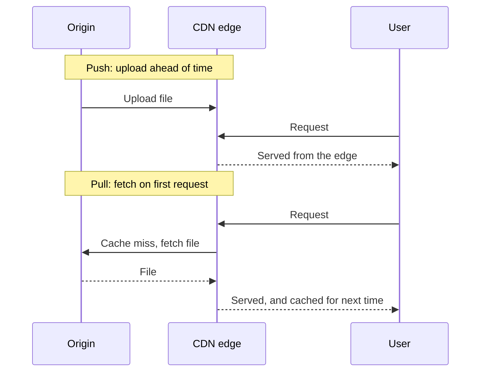
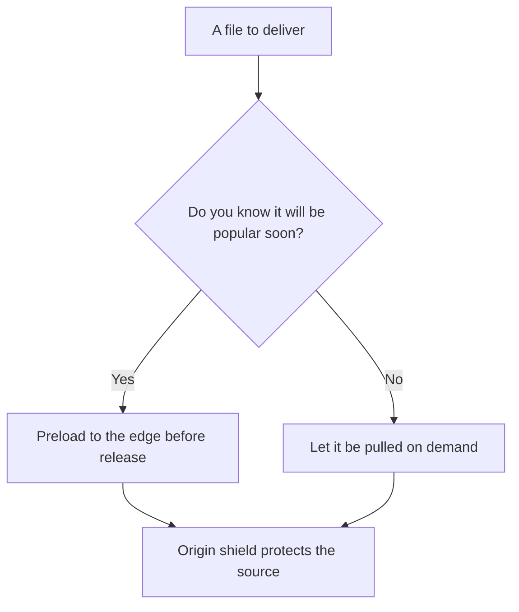

# Push vs Pull CDNs

> **TL;DR**: A pull CDN fetches files from your origin the first time someone asks, which suits most sites because it needs almost no setup. A push CDN has you upload files in advance, which suits large files and big launches where a slow first request or a flood to your origin would hurt. Plenty of systems use both.

## Learning Objectives

After this module, you will be able to:

- [ ] Explain how content reaches the edge in each model
- [ ] Choose a model from file size, traffic pattern and how often content changes
- [ ] Avoid stale content using versioned file names
- [ ] Protect an origin from a stampede

## The Core Trade-off

The question is who moves the content, and when.

*Push does the work before any user arrives, and pull has the first user trigger it.*

## Side-by-Side Comparison

| Dimension | Push | Pull |
|---|---|---|
| Who loads the edge | You, through a deploy or upload step | The CDN, on a cache miss |
| Setup | Upload pipeline and URL rewriting | Point the CDN at your origin and rewrite URLs |
| First request | Fast, since it is already there | Slower, since it has to go to the origin |
| Storage used | Everything you upload | Only what was requested recently |
| Origin load | Low after upload | Depends on hit rate and TTLs |
| Updating content | You upload again, and control exactly when | Wait for the TTL or purge |
| Wasted transfer | Files nobody requests | Refetching files that have not changed, though revalidation reduces it |

## When to Pick Push

- Files are large and expensive to fetch at request time, such as video or game downloads.
- A launch is coming, and you know exactly what will be requested, all at once.
- Content rarely changes and you want no surprise fetches from your origin.
- Your origin cannot take the load of many edge locations fetching at once.

## When to Pick Pull

- You serve a typical website or app with many assets, where usage varies.
- Content changes often, and you would rather not manage uploads.
- The catalog is big and most of it is rarely requested, so storing it all at every location would waste money.
- You want the simplest setup.

## The Hybrid Path

Most large systems combine these:

*Preload what you can predict, and let everything else be pulled.*

- **Preloading on a pull CDN.** Many pull CDNs let you warm chosen files before a release, which gives you push behaviour for just those files.
- **Origin shield.** A middle cache layer between edges and your origin means many edge locations missing at once produce one fetch rather than hundreds.
- **Object storage as the origin.** Uploading to object storage and having the CDN pull from it gives you a simple upload step, without overloading app servers.
- **Versioned file names.** Names such as `app.3f9a1c.js` never change, so they can be cached for a long time. A new release simply refers to a new name, and no purge is needed.

## Real-World Examples

These scenarios are illustrative.

- **Documentation site:** pull. Pages change at any time, and hit rates are high for popular pages.
- **Major game patch:** push or preload. Millions of people download the same large files at the same moment, so a cold start would hammer the origin.
- **Video streaming:** both. Popular titles are placed at the edge ahead of demand, while rarely watched ones are fetched when needed. [Netflix Open Connect](../part-2-building-blocks/02-cdns.md) is a well-known example of preloading.

## Common Mistakes

> **Long TTLs on files with fixed names.** Updating `app.js` leaves users on the old copy until the TTL expires. Use versioned names for long-lived assets, and short TTLs on the HTML that references them.

> **A launch on a cold pull CDN.** Everyone misses at once, and the origin takes the full stampede. Preload key files, and use request collapsing or an origin shield.

> **Pushing files nobody requests.** Uploading a huge catalog everywhere costs storage for content few users want.

> **Forgetting the deploy order with push.** If the HTML goes live before the new assets are uploaded, users get broken pages. Upload the assets first and keep old versions around for a while.

## Decision Checklist

- [ ] Do you know which files will be popular, and when? Preload those.
- [ ] Are files large enough that a slow first fetch is unacceptable? Lean towards push.
- [ ] Does most content get few requests? Lean towards pull.
- [ ] Can the origin survive every edge location missing at once? If not, add a shield.
- [ ] Do long-lived assets have versioned names?

## Key Takeaways

- Pull is the sensible default, because it is simple and stores only what gets requested.
- Push gives you control and removes the slow first request, at the cost of an upload pipeline and extra storage.
- The usual answer is pull, with preloading for predictable peaks.
- Versioned file names remove most invalidation pain in both models.
- Protect the origin with a shield and request collapsing.

## Further Reading

- [Content delivery networks](../part-2-building-blocks/02-cdns.md) covers how edge networks work, plus cache keys and purging.
- [Push vs pull for fan-out and messaging](18-push-vs-pull.md) applies the same choice to a different problem.

## Flashcards

**Q:** How does a pull CDN get a file?
**A:** It fetches from the origin on the first cache miss, then serves later requests from the edge until the file expires.

**Q:** What is the main drawback of pull?
**A:** The first request at each location is slower, and a sudden peak can flood the origin with misses.

**Q:** What is the main drawback of push?
**A:** You must run an upload process and pay to store everything you push, including files nobody requests.

**Q:** Which model suits a game patch launch?
**A:** Push or preloading, because everyone wants the same large files at once.

**Q:** Why do versioned file names help?
**A:** A new version gets a new name, so files can be cached for a long time without purging.

**Q:** What does an origin shield do?
**A:** It places a middle cache in front of the origin, so many edge misses become one origin fetch.

## References

- Donne Martin, "Content delivery network," The System Design Primer. https://github.com/donnemartin/system-design-primer#content-delivery-network
